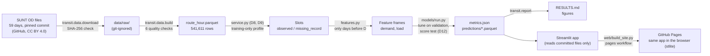

# Architecture

Data flows in one direction. Each stage is a command that reads the previous stage's committed output, so a reviewer can rerun any stage and compare the files.



## Stages

| Stage | Command | Reads | Writes | Tests |
| --- | --- | --- | --- | --- |
| Download | `python -m transit.data.download` | `data/manifest/sunt_od_manifest.csv` | `data/raw/sunt_od/*.parquet` | `test_pipeline_e2e.py` (checksum, skip) |
| Aggregate | `python -m transit.data.build` | raw files | `data/processed/route_hour.parquet`, `quality_report.json` | `test_aggregate.py`, `test_inputs_and_time.py`, `test_pipeline_e2e.py`, `test_processed.py` |
| Slots | `transit.data.service.build_slots` | route-hour table | in memory | `test_service.py` |
| Features | `transit.features.build_features` | slots | in memory | `test_features_and_baselines.py` (no-leakage test) |
| Train and evaluate | `python -m transit.models.run` | route-hour table | `reports/metrics.json`, `reports/tuning_*.csv`, `data/predictions/*.parquet`, `models/` (git-ignored) | `test_app.py` (metrics match predictions) |
| Report | `python -m transit.report` | metrics and predictions | `reports/RESULTS.md`, `reports/figures/*.png` | stops if metrics and predictions disagree |
| Dashboard | `streamlit run app/streamlit_app.py` | metrics and predictions | nothing | `test_app.py` (every page renders) |
| Verify a rerun | `python -m transit.verify` | rebuilt table and metrics, committed versions from git | nothing | `test_verify.py` |
| Publish the public site | `python web/build_site.py OUT` (run by `.github/workflows/pages.yml`) | `web/index.html` and the files it lists | the `gh-pages` branch: page, app code, results, SHA-256 manifest, pinned wheels | `test_web.py` |

## Key design choices

- **Prediction unit:** route × direction × clock hour (D7). One service day runs from about 03:45 to 02:15; `service_hour` 24–26 means 00:00–02:00 the next morning.
- **Forecast setting:** day-ahead. Every feature for service day D comes from days before D (lags of 1, 7, 14, 21 and 28 days, rolling means, same-day-type history, lagged trip counts, route totals).
- **Missing data:** absent hours are missing, never zero (D8). Hours a route runs regularly but SUNT did not record are kept as `missing_record` slots: predicted, shown, never scored.
- **Targets:** `boardings` (demand) and `load_trip_peak_mean`, the mean over a route-hour's trips of each trip's highest estimated load (occupancy). Loads are SUNT estimates, not measurements.
- **Models:** LightGBM gradient-boosted trees, with route as a categorical feature. They are compared against three baselines on identical rows.
- **Crowding:** load factor against ABNT NBR 15570 minimum capacities, with four capacity scenarios (D10).
- **Reproducibility:** pinned source commit and checksums; deterministic LightGBM (fixed seed, `deterministic=True`); the dashboard and the report read only committed outputs.

## Code map

```
src/transit/
  config.py           paths, pinned source, split dates
  data/manifest.py    pinned file list and SHA-256
  data/download.py    verified download
  data/aggregate.py   stop events -> route-hours (+ malformed-trip flag)
  data/build.py       59-day build and quality checks
  data/service.py     service profile, slots, scope (D8, D9)
  features.py         day-ahead features without leakage
  metrics.py          MAE, RMSE, WAPE, bias; macro-F1, confusion matrix
  crowding.py         capacity scenarios and levels (D10)
  models/baselines.py three baselines with recorded fallbacks
  models/lgbm.py      LightGBM fit, early stopping, prediction
  models/run.py       tuning, ablation, refit, test scoring, intervals, forecast
  report.py           RESULTS.md and figures
  verify.py           compare a rerun with the committed table and metrics
app/streamlit_app.py  dashboard
app/design.py         dashboard look: colours, bundled fonts, CSS, chart template
web/                  public in-browser build (index.html, build_site.py, wheels.txt)
```

## Reproduction record

**24 Oct 2026, fresh clone of `main` at `d3e94af`, Linux, 2 CPU threads, Python 3.12.3, pandas 3.1.0, pyarrow 26.0.0, LightGBM 4.7.0** (the committed results were made with Python 3.13 and pandas 3.0.5):

| Step | Result |
| --- | --- |
| `transit.data.download` | 59 files downloaded, all SHA-256 checksums matched |
| `transit.data.build` | all 6 quality checks passed; table identical to the committed one in every cell (541,611 rows × 12 columns) |
| `transit.models.run` | 479 s; all 2,326 numbers in `metrics.json` identical to the committed file (only wall-clock times differ) |
| Prediction files | all 5 identical in content to the committed files |
| `transit.report` | `RESULTS.md` and `planning.json` byte-identical to the committed files |
| `pytest` | 77 passed |

The whole sequence took about 11 minutes. The parquet files differ in bytes only in their metadata (which records the pandas version), not in content. Not yet repeated on Windows or Colab.

