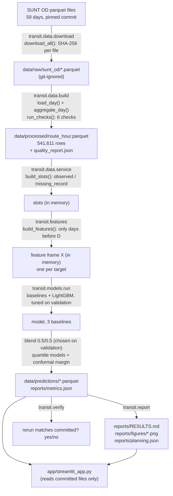

# Project code walkthrough

A guided tour of the code, written for the five of us before the evaluation. It follows the data from the raw SUNT files to the dashboard, names the real files and functions at every step, and ends with a reading path and exercises for each member.

The goal is understanding, not a script to memorise. If you can do the exercises for your part without looking at the answers, you can handle follow-up questions in the viva, because you will know *where to look* and *why the code does what it does*.

This guide is about the **code**. It complements the other team documents rather than repeating them: what each speaker says is in [TEAM_PRESENTATION_GUIDE.md](TEAM_PRESENTATION_GUIDE.md), harder questions with short answers are in [VIVA_QUESTION_BANK.md](VIVA_QUESTION_BANK.md), and laptop setup and the demo script are in [DEMO_RUNBOOK.md](DEMO_RUNBOOK.md).

- Numbers quoted here come from `reports/RESULTS.md`, `reports/metrics.json` or the committed prediction files. The worked example in section 3 was traced on 24 Oct 2026 from the committed files on `main`.
- Line numbers are given as `file.py:NN` for the state of `main` on 24 Oct 2026. If the code changes, search for the function name instead.
- "Load" always means **estimated on-board load** (from SUNT's fare-card trip chaining), never measured occupancy.

## Contents

1. [The system in one picture](#1-the-system-in-one-picture)
2. [Stage by stage](#2-stage-by-stage)
3. [Following one route-hour through the system](#3-following-one-route-hour-through-the-system)
4. [Design decisions, alternatives and limitations](#4-design-decisions-alternatives-and-limitations)
5. [Reading paths and exercises for each member](#5-reading-paths-and-exercises-for-each-member)
6. [Checking yourself](#6-checking-yourself)

## Before you start

Set up once (Windows PowerShell, macOS or Linux; the commands are the same):

```bash
git clone https://github.com/jayvaghela779/cs3011-public-transport-demand-occupancy.git
cd cs3011-public-transport-demand-occupancy
pip install -r requirements.txt
pip install -e .          # makes `import transit` work from anywhere
pytest -q                 # 93 tests, about 15 seconds
```

If anything fails on Windows, [DEMO_RUNBOOK.md](DEMO_RUNBOOK.md) has step-by-step setup and troubleshooting.

You do **not** need to download SUNT (510 MB) to follow this guide. The route-hour table, the prediction files and `metrics.json` are committed, and every exercise below works from them. Only stage 1 (download) and stage 2 (build) need the raw files.

To poke at the data interactively, start Python in the repository folder:

```python
import pandas as pd
d = pd.read_parquet("data/predictions/demand_test.parquet")
d.head()
```

---

## 1. The system in one picture

Data flows in one direction. Each stage is a command (or a function called by the next command) that reads the previous stage's output.



The same flow as plain text (for printing):

```
SUNT files ──download──▶ data/raw ──build──▶ route_hour.parquet ──┐
 (59 days)   SHA-256       (ignored)  6 checks  + quality_report    │
                                                                    ▼
                                    models.run: build_slots ─▶ build_features
                                                                    │
                       baselines  ◀─────────────────────────────────┤
                       LightGBM (tune on valid, refit train+valid) ◀┘
                              │
                              ▼ blend 0.5·LightGBM + 0.5·historical average
                              ▼ 80% interval (quantile models + conformal margin)
              data/predictions/*.parquet + reports/metrics.json
                     │                              │
               transit.report                streamlit_app.py
          RESULTS.md, figures, planning.json   (5 pages, offline)
```

### Where each piece lives

| Path | What it does |
| --- | --- |
| `src/transit/config.py` | Paths, the pinned SUNT commit, study dates and the train/validation/test split |
| `src/transit/data/manifest.py` | The list of 59 files with sizes and SHA-256 hashes |
| `src/transit/data/download.py` | Downloads and verifies the files |
| `src/transit/data/aggregate.py` | One day of stop events → route × direction × hour |
| `src/transit/data/build.py` | Runs `aggregate_day` for 59 days, runs the quality checks, writes the table |
| `src/transit/data/service.py` | Day types, the service profile, modelling slots (missing hours, D8) |
| `src/transit/features.py` | Day-ahead features with no future information |
| `src/transit/models/baselines.py` | The three baselines and their fallback chain |
| `src/transit/models/lgbm.py` | LightGBM settings, tuning grid, training and prediction |
| `src/transit/models/run.py` | The whole experiment: tuning, ablation, refit, blend, intervals, test scoring, next-day forecast |
| `src/transit/metrics.py` | MAE, RMSE, WAPE, bias; macro-F1 and confusion matrix |
| `src/transit/crowding.py` | Capacity scenarios and crowding levels (D10) |
| `src/transit/report.py` | Writes `RESULTS.md`, the figures, the bootstrap and the alert-list evaluation |
| `src/transit/verify.py` | Checks that a rerun matches the committed table and metrics |
| `app/streamlit_app.py` | The dashboard |
| `web/index.html`, `web/build_site.py`, `web/wheels.txt` | The public in-browser build of the dashboard (GitHub Pages, stlite) |
| `.github/workflows/pages.yml` | Publishes that build to the `gh-pages` branch when the app or results change on `main` |
| `tests/` | 93 pytest tests (CI runs them on Ubuntu and Windows) |

---

## 2. Stage by stage

Each stage lists: the command, the files, the important functions, what goes in and out, the tests that protect it, and the one idea you must be able to explain.

### Stage 0. Configuration: `src/transit/config.py`

- **What:** constants only. `SUNT_COMMIT` pins the exact SUNT version. `START_DATE`/`END_DATE` give the 59-day study period (1 Mar–28 Apr 2024). `TRAIN_END = 2024-04-07` and `VALID_END = 2024-04-14` define the chronological split; test is 15–28 Apr.
- **Tests:** `tests/test_config.py` (`test_study_period_is_59_days`, `test_split_is_chronological_and_inside_study_period`, `test_sunt_source_is_pinned_to_a_full_commit_sha`).
- **Idea to explain:** all the choices that decide *which data* and *how it is split* are in one file, so a reviewer can check them in one place.

### Stage 1. Raw SUNT files and checksums

- **Command:** `python -m transit.data.download` (add `--limit 3` for a quick try).
- **Files:** `src/transit/data/manifest.py`, `src/transit/data/download.py`, `data/manifest/sunt_od_manifest.csv`.
- **Important functions:**
  - `manifest.read_manifest()` reads the CSV of `date, filename, bytes, sha256`.
  - `manifest.sha256_of(path)` hashes a file in 1 MB chunks.
  - `download.fetch(url, dest)` downloads to a `.part` file with 3 retries, then renames it, so an interrupted download never leaves a half file under the real name.
  - `download.download_all()` skips a file that is already present with the right size and hash (`download.py:52`), otherwise downloads it and compares the hash; on a mismatch it deletes the file and raises `RuntimeError` (`download.py:56-59`).
- **In:** the manifest. **Out:** `data/raw/sunt_od/od-2024-03-01.parquet` … `od-2024-04-28.parquet` (git-ignored, never committed).
- **Tests:** `tests/test_pipeline_e2e.py`: `test_manifest_round_trip`, `test_download_verifies_and_skips`, `test_download_rejects_checksum_mismatch` (these use a fake download, not the network).
- **Idea to explain:** the URL contains the commit hash *and* every file has a SHA-256, so we can prove we trained on exactly the bytes the results came from. If SUNT changes its files, our download fails loudly instead of silently giving different results.

### Stage 2. Validation and route-hour aggregation

- **Command:** `python -m transit.data.build`.
- **Files:** `src/transit/data/aggregate.py`, `src/transit/data/build.py`.
- **Important functions:**
  - `aggregate.load_day(path)` reads only the 8 columns we use and renames SUNT's hyphenated `n-boardings`/`n-alighting` to `n_boardings`/`n_alighting`. Timestamps that cannot be parsed become `NaT`.
  - `aggregate.malformed_trip_ids(df)` finds trips that visit the same `pt_sequence` twice (decision D9).
  - `aggregate.aggregate_day(df, service_date)` is the core:
    1. keeps stop events inside the 30-hour window from the service date's midnight (`aggregate.py:76`); events outside are counted, not silently lost;
    2. sets `ts_hour = stop_time.floor("h")` (`aggregate.py:79`), the **clock hour**;
    3. groups by `(route, direction, ts_hour)` and computes `boardings`, `alightings`, `n_stop_events`, `n_trips`, `load_max`, `n_burst_events`;
    4. computes `load_trip_peak_mean` in two steps (`aggregate.py:92-93`): each trip's maximum load within the hour, then the mean over trips. This is "a typical bus's peak load in that hour", our occupancy target;
    5. counts malformed trips per route-hour;
    6. returns a per-day `stats` dict for the quality report.
  - `build.run_checks(table, per_day, expected_days)` runs six checks: unique keys, all 59 days present, boardings conserved exactly, no negative aggregated values, malformed trips under 0.1%, almost no events outside the window.
  - `build.build()` loops over the 59 days, concatenates, sorts, runs the checks and writes the files. `build.main()` exits with status 1 if any check fails.
- **In:** 59 raw files, 37,600,997 stop events. **Out:** `data/processed/route_hour.parquet` (541,611 rows × 12 columns) and `data/processed/quality_report.json`.
- **Tests:** `tests/test_aggregate.py` (sums, conservation, window, after-midnight hours, bursts, malformed trips, renamed columns, check failures), `tests/test_inputs_and_time.py` (SUNT's categorical types, all-missing loads become NaN not 0, unparseable times, hour boundaries, exclusive window end), `tests/test_pipeline_e2e.py::test_build_two_days_end_to_end`, `tests/test_processed.py` (the committed table agrees with its report and with pinned totals).
- **Idea to explain:** aggregation must not invent or lose passengers. `boardings_conserved` compares the raw sum with the aggregated sum for every day; the largest relative difference in the committed build is 0. Burst events (> 100 boardings at one stop) and malformed trips are **counted and flagged, not removed**, so total demand is preserved and the decision about them is made later, in writing (D9, D11).

### Stage 3. Service profile and missing hours: `src/transit/data/service.py`

This stage runs inside `python -m transit.models.run` (it has no command of its own).

- **The problem:** the table only has a row when SUNT recorded a stop event. An absent hour might be "no bus scheduled" or "a bus ran but SUNT has no record". SUNT's timetable covers May–June 2024, not our period, so it cannot tell us which.
- **Important functions:**
  - `daytype(d)` labels each date `weekday`, `saturday`, `sunday` or `holiday` (only Good Friday, 29 Mar 2024, is in `HOLIDAYS`).
  - `add_calendar(table)` adds `service_hour` = hours since the service date's midnight. A service day runs from about 03:45 to 02:15, so 01:00 the next morning is `service_hour` 25. It also adds `dow`, `daytype` and `is_holiday`.
  - `service_profile(table)` counts, **from training days only**, how often each `(route, direction, daytype, service_hour)` cell was observed. A cell is `regular` if `share >= REGULAR_SHARE` (0.8).
  - `in_scope_route_directions(table)` keeps route-directions seen on at least `MIN_TRAIN_DAYS` (10) training days.
  - `build_slots(table, dates=...)` builds the list of things to predict. It outer-merges "expected" slots (regular cells × calendar dates) with the observed rows (`service.py:115`). Rows only in the expected list become `status = "missing_record"` (`service.py:117`); their measures stay `NaN`. It also sets `load_reliable` (False for malformed trips or a missing load).
- **In:** the route-hour table. **Out:** a slot table in memory. Committed evidence: the prediction files keep the `status` column.
- **Counts (all slots, from `build_slots` on the committed table):** train 348,243 observed + 3,309 missing records; validation 64,273 + 1,060; test 127,935 + 2,797; the 29 Apr forecast day has 9,566 slots, all `missing_record`, because no data exists for that day yet.
- **Tests:** `tests/test_service.py`: `test_regular_threshold_is_80_percent_of_training_days`, `test_profile_uses_training_days_only`, `test_absent_regular_hour_becomes_missing_record_not_zero`, `test_irregular_hours_get_no_slots_but_observed_rows_stay`, `test_observed_zero_boardings_are_kept_as_zero`, `test_route_directions_with_little_training_history_are_out_of_scope`, `test_malformed_route_hours_are_not_load_reliable`.
- **Idea to explain:** **an absent hour is missing data, not zero demand** (D8). Filling it with 0 would invent fake "zero passenger" hours and make the test set easier. An observed hour with 0 boardings (a bus ran, nobody tapped) *is* a real zero and is kept.

### Stage 4. Feature generation: `src/transit/features.py`

- **Forecast setting:** before service day D starts (about 03:00), predict every slot of day D. Every feature for day D comes from days strictly before D. Day D−1 ends around 02:15, before day D's first trip, so all of yesterday is known in time.
- **Important functions:**
  - `target_series(slots, target)` returns the target only where it may be used: `NaN` for missing records, and for load also `NaN` where `load_reliable` is False.
  - `_lag_frame(slots, value, name, lags)` shifts each value forward by k days and merges it back on `(route, direction, service_hour, service_date)`. So `y_lag7` for Wednesday 17 Apr 08:00 is the value at Wednesday 10 Apr 08:00. Missing days give `NaN`, never 0.
  - `_expanding_daytype_mean(slots, value)` gives `y_hist_daytype`: the mean of **all earlier** observed values in the same cell and day type. The trick is at `features.py:56`: `cumsum() - current value` is the sum of strictly earlier days, so day D's own value is never included.
  - `_route_day_total(slots, value)` gives `rd_total_lag1` and `rd_total_lag7`: the whole route-direction's total on the previous day and a week earlier.
  - `build_features(slots, target)` assembles everything and adds `target` and `n_burst_events` (used for reporting only, not as a model input).
  - `model_feature_names(target)` is the exact list the model sees: `route`, `direction` (categorical), five calendar features, five lags (1, 7, 14, 21, 28 days), `y_mean_dow4`, `y_roll7`, `y_hist_daytype`, two lagged trip counts, two route-day totals, and, for the load model only, `boardings_lag7` and `boardings_mean_dow4`.
- **In:** slots. **Out:** a feature frame `X`, one row per slot, built separately for each target.
- **Tests:** `tests/test_features_and_baselines.py`:
  - `test_features_for_day_d_ignore_day_d_and_later` multiplies all data from day D onward by 50 and checks that day D's features do not change. This is the **no-leakage test**.
  - `test_lag7_and_lag1_are_exact_earlier_values`, `test_hist_daytype_mean_uses_only_earlier_same_type_days`, `test_missing_records_are_nan_in_lags_not_zero`.
- **Idea to explain:** leakage means using information you would not have at forecast time. We prevent it by construction (only shifted or strictly-earlier values) and prove it with a test that changes the future and checks the features stay the same.

### Stage 5. Baselines and LightGBM

All of this runs inside `python -m transit.models.run` (about 8 minutes on 2 CPU threads; the committed run took 450 s).

- **Baselines** (`src/transit/models/baselines.py`):
  - `seasonal_naive` = `y_lag7` (same hour last week), `dow4_mean` = `y_mean_dow4` (mean of the last 4 same weekdays), `hist_average` = `y_hist_daytype` (mean of all earlier days of the same day type at that hour).
  - `predict(X, name, medians)` tries the primary column, then the fallbacks `y_hist_daytype` and `y_roll7`, then the training median for that hour (`hour_medians`). It returns the prediction *and* which column it came from, so every scored row has a baseline prediction and the fallback use is recorded in `metrics.json` under `baseline_fallbacks`.
- **LightGBM** (`src/transit/models/lgbm.py`):
  - `BASE_PARAMS`: learning rate 0.05, `min_data_in_leaf` 50, feature and bagging fraction 0.8, L2 regularisation 1.0, `seed` 42, `deterministic=True`, 2 threads.
  - `GRID`: six configurations per target (objectives `regression`, `regression_l1`, `poisson`, `tweedie`/`huber`; 63 or 255 leaves).
  - `fit_with_early_stopping(train, valid, features, config)` trains up to 3,000 rounds and stops when validation L1 error has not improved for 100 rounds.
  - `fit_fixed_rounds(train, features, config, rounds)` refits for a fixed number of rounds.
  - `predict(model, X, features)` clips predictions at 0 (boardings and loads cannot be negative).
- **The experiment** (`run.run_target`, `run.py:85`):
  1. `scored` = rows with a known target; split into train/valid/test by `split_of(service_date)`.
  2. Fit every grid configuration on train with early stopping on validation; keep the lowest validation WAPE. Chosen for both targets: `regression_l1`, 63 leaves (130 rounds for demand, 140 for load).
  3. Feature-group ablation on validation with the chosen configuration.
  4. Refit on train + validation for the same number of rounds (`run.py:121`) and save it to `models/` (git-ignored).
- **Tests:** `tests/test_features_and_baselines.py::test_baseline_fallback_chain_covers_every_row`; `tests/test_models_run.py` runs `run_target` end to end on a small synthetic table (`test_run_target_produces_complete_results`, `test_learned_model_beats_last_week_on_a_learnable_pattern`).
- **Idea to explain:** a model is only worth having if it beats simple rules on the same rows. The validation week chooses everything; the test weeks are only for the final score.

### Stage 6. Blending and prediction intervals (`run.py`)

- **Blend (decision D12):** on the validation week, try `w × LightGBM + (1 − w) × historical average` for `w` in `BLEND_WEIGHTS = [0, 0.25, 0.5, 0.75, 1]` (`run.py:139-142`). The lowest validation WAPE wins: `w = 0.5` for both targets. The column is called `ensemble` in the prediction files.
- **Why a blend exists at all:** the first full run (v1) scored LightGBM alone on test and it tied the historical average (18.39% vs 18.35%). The blend was then chosen on validation only and scored once more on test. Both runs are reported; the test weeks have been scored twice. This is disclosed in `RESULTS.md`, `DECISIONS.md` D12 and `metrics.json` (`test_scoring_history`).
- **80% intervals (decision D13):**
  1. Two quantile LightGBM models (α = 0.1 and 0.9), early-stopped on validation and refit on train + validation (`run.py:148-152`).
  2. A split-conformal margin: on validation, the score for each row is `max(lo − y, y − hi)`; the margin is its 80% quantile with the finite-sample correction (`run.py:160-162`). Intervals become `[lo − margin, hi + margin]`, with the lower end clipped at 0.
  3. In our run the margin is about 0 (0.00026 for demand, 0.0 for load): the raw quantile models were already close to 80% on validation.
- **Tests:** `tests/test_models_run.py::test_ensemble_is_the_documented_blend`, `test_blend_weight_is_chosen_on_validation_not_test`; `tests/test_app.py::test_forecast_file_is_the_same_blend_as_evaluated`, `test_interval_coverage_matches_prediction_files`.
- **Idea to explain:** averaging two forecasts whose errors differ usually reduces error; the weight was chosen without looking at test. The interval is a *long-run* 80% coverage rate, not a promise for any single hour, and it fails for estimated load at night (about 52% coverage for 00:00–02:00).

### Stage 7. Prediction and evaluation files

- **Metrics** (`src/transit/metrics.py`):
  - `regression_metrics(y, p)` returns MAE, RMSE, **WAPE = Σ|p − y| / Σ|y|** (`metrics.py:22`) and bias = mean(p − y). It refuses `NaN` inputs, so a missing record can never be scored by accident.
  - `classification_metrics(y_true, y_pred, labels)` returns accuracy, macro-F1, per-class precision/recall/F1 and the confusion matrix (scikit-learn underneath).
- **Crowding** (`src/transit/crowding.py`): `crowding_level(load, capacity)` computes the load factor `load / capacity` and labels it `low` (< 0.5), `medium` (0.5–0.8) or `high` (≥ 0.8); `NaN` becomes `None`. `CAPACITY_SCENARIOS` = midiônibus 40, ônibus básico 70 (base), padron 80, articulado 100, from ABNT NBR 15570 (decision D10).
- **What `run.py` writes:**
  - `data/predictions/demand_valid.parquet`, `demand_test.parquet`, `load_valid.parquet`, `load_test.parquet`: one row per slot (observed and missing records), with `target`, `ensemble`, `model` (LightGBM alone), `lo`, `hi`, and the three baselines.
  - `data/predictions/forecast_2024-04-29.parquet`: the next-day forecast for both targets (9,566 route-hours, no actuals).
  - `reports/metrics.json`: validation and test metrics, tuning results, ablation, blend weights, intervals, error segments, crowding results for every capacity, baseline fallback counts and the test-scoring history.
  - `reports/tuning_demand.csv`, `reports/tuning_load.csv`.
- **Error analysis** is also in `run_target` (`run.py:197-231`): by period of day (`PERIODS`, `period_of`), day type, route-volume tercile, regular vs non-regular cell, test day, worst route-directions, zero-boarding hours, and (for load) burst hours.
- **Tests:** `tests/test_features_and_baselines.py::test_regression_metrics_known_values`, `test_crowding_levels_and_scenarios`; `tests/test_app.py::test_reported_test_metrics_match_prediction_files`, `test_missing_records_are_never_scored`.

### Stage 8. Results report and the reproducibility check

- **Command:** `python -m transit.report`, then `python -m transit.verify`.
- **`src/transit/report.py`:**
  - Reads `metrics.json` and the prediction files and writes `reports/RESULTS.md`, five figures in `reports/figures/`, and `reports/planning.json`. You never edit numbers in `RESULTS.md` by hand.
  - `recompute_check(metrics)` (`report.py:148`) recomputes every test WAPE from the prediction files and **stops the script** if it disagrees with `metrics.json`.
  - `bootstrap_wape_diff(short, a, b)` (`report.py:163`) is a paired cluster bootstrap: it resamples whole route-directions (664 for demand) 2,000 times, because hours of the same route are correlated. It gives the 95% interval of the WAPE difference, e.g. −0.29 to −0.06 points for final minus historical average (demand).
  - `coverage_by_segment(split)` (`report.py:184`) splits interval coverage by period of day and weekday/weekend; this is where the night-time load gap shows up.
  - `planning_topk()` (`report.py:207`) evaluates a daily alert list: each test day, take the K route-hours with the highest forecast load and measure how many were really high crowding at capacity 70.
- **`src/transit/verify.py`:** `main()` compares the rebuilt route-hour table cell by cell with the committed one (`git show HEAD:...`), then compares all 2,326 numbers in `metrics.json` with the committed file (relative tolerance 1e-6, run times ignored). Exit status 1 if anything differs. Because it reads the committed versions through git, it needs a git clone, not a ZIP download; without git it prints `NEEDS_GIT` (an explanation) and exits with status 2. `python -m transit.verify OLD.json NEW.json` compares any two metrics files without git.
- **Tests:** `tests/test_verify.py`; `tests/test_app.py::test_planning_precision_matches_prediction_files`, `test_report_coverage_by_period_agrees_with_metrics`.
- **Idea to explain:** the write-up cannot drift from the evaluation, because it is generated from it and checks itself. A fresh-clone rerun on 24 Oct reproduced every committed number (`docs/ARCHITECTURE.md#reproduction-record`).

### Stage 9. Streamlit dashboard: `app/streamlit_app.py`

- **Command:** `streamlit run app/streamlit_app.py`. It reads only committed files, so it starts offline with no download.
- **Public copy:** the same file runs in the browser at https://jayvaghela779.github.io/cs3011-public-transport-demand-occupancy/ (GitHub Pages). `web/index.html` loads it with stlite (Streamlit on Pyodide), fetches the app code and committed results through jsDelivr's mirror of the `gh-pages` branch, checks each file's SHA-256 against `site-manifest.json`, and falls back to GitHub Pages for any mismatching copy. `.github/workflows/pages.yml` runs `web/build_site.py` to publish it. `tests/test_web.py` fails if the page's file list misses anything the app reads.
- **Loading:** `load_metrics()` and `load_predictions(name)` are wrapped in `@st.cache_data`, so files are read once per session.
- **Pages** (chosen in `main()` from the sidebar):
  - `page_explorer`: pick period (test or validation), route-direction (busiest first, from `route_options`) and day. `day_chart` draws actual, final forecast, last-week rule and the 80% band; open circles are missing records (predicted, not scored). The **capacity slider** (`streamlit_app.py:124`) draws the medium/high threshold lines and recolours the crowding strip.
  - `page_comparison`: the test metrics table (`metrics_table`), a live recompute check, error breakdowns, tuning results, ablation, feature importance.
  - `page_crowding`: every capacity scenario, a confusion matrix, burst hours.
  - `page_forecast`: the 29 Apr forecast, the top high-crowding route-hours and the alert-list precision from `planning.json`. It is labelled as a demonstration, not an evaluated result.
  - `page_data`: data source, split, the estimated-load caveat (`ESTIMATE_NOTE`), D8, D9, bursts, capacity, interval gap.
- **Tests:** `tests/test_app.py::test_page_renders` runs every page with Streamlit's `AppTest` and fails on any exception; `test_explorer_route_and_split_selection`.
- **Idea to explain:** the dashboard does no modelling. It displays the committed predictions and recomputes simple things (WAPE for one day, crowding levels for a chosen capacity) on the fly.

---

## 3. Following one route-hour through the system

**Route 137, direction I, Wednesday 17 April 2024, 08:00** (a test day; route 137 I is the busiest route-direction in the test weeks, which is why `report.fig_example` plots it).

| Step | Where | Value |
| --- | --- | --- |
| Raw | `od-2024-04-17.parquet` | many stop events of route 137 I with `stop_time` between 08:00 and 08:59 |
| Aggregated | `route_hour.parquet`, `ts_hour = 2024-04-17 08:00` | `boardings` 1266.70; 5 burst events in the hour |
| Slot | `build_slots` | `status = observed`, `regular = True`, `service_hour = 8`, `daytype = weekday` |
| Features | `build_features(slots, "boardings")` | `y_lag1` 1276.41 (Tue 16 Apr), `y_lag7` 1156.55 (Wed 10 Apr), `y_mean_dow4` 1268.18, `y_roll7` 977.08, `y_hist_daytype` 1165.80, `trips_lag7` 16 |
| Baselines | `baselines.predict` | last week 1156.55 (= `y_lag7`), last 4 weekdays 1268.18 (= `y_mean_dow4`), historical average 1165.80 (= `y_hist_daytype`) |
| LightGBM | `lgbm.predict(final, ...)` | 963.53 |
| Final forecast | `0.5 × 963.53 + 0.5 × 1165.80` | **1064.67** |
| 80% interval | quantile models + margin | 633.7 to 1502.5 (the actual, 1266.7, is inside) |
| Stored in | `data/predictions/demand_test.parquet` | columns `target`, `model`, `hist_average`, `ensemble`, `lo`, `hi`, ... |

Things worth noticing (good viva material):

- **The baselines are just feature columns.** No separate computation: the historical average *is* `y_hist_daytype`.
- **`y_hist_daytype` = 1165.80 is the mean of 32 earlier weekdays** at 08:00 for route 137 I: the training weekdays, the validation weekdays, and the test days 15 and 16 April. That is correct for a day-ahead forecast (yesterday's data is known before today starts), and it is why the historical average keeps improving through the test weeks. The *model* is not retrained during the test weeks; only its inputs move forward.
- **`y_roll7` is lower (977)** because it averages the last 7 calendar days at 08:00, including Saturday and Sunday, when this route carries fewer people.
- **In this hour LightGBM under-predicts** (963.5 vs 1266.7) and the blend pulls it halfway back towards the historical average. Look at `reports/figures/example_route_day.png`: the morning peak (06:00–08:00) is where the final forecast is furthest below the actual on this day. Do not claim the model is always closer than the baselines; for this hour the last-week rule was closer. In fact 17 April is the only test day on which the final forecast's demand WAPE was higher than the historical average's (16.74% against 16.59%; `metrics.json` → `segments_test.by_day`). The example was chosen by a fixed rule in `report.fig_example` (busiest route-direction, first test Wednesday), not to flatter the model.

The estimated-load row for the same slot (`load_test.parquet`): actual 90.9, final forecast 90.0, historical average 91.8, LightGBM 88.3. At capacity 70 the load factor is 90.9 / 70 ≈ 1.30, so both actual and forecast are **high** crowding.

To reproduce this trace yourself, see exercise J1 below.

---

## 4. Design decisions, alternatives and limitations

The full log is `docs/DECISIONS.md` (D1–D13). These are the ones you are most likely to be asked about.

| Decision | What we did | Alternative considered | Why ours |
| --- | --- | --- | --- |
| Dataset (D1) | SUNT, Salvador, CC BY 4.0 | Indian sources (Bengaluru metro and others), Victoria train counts, the Pune GTFS repository, the Aarhus thesis data | SUNT was the only candidate we could download and open that had both demand and on-board load. GTFS timetables have no passenger counts. |
| Occupancy label (D2) | "Estimated on-board load" from trip chaining | Calling it occupancy | Alightings are inferred, not counted. Calling it measured would be false. |
| Unit (D7) | Route × direction × clock hour | Stop level; 15-minute bins | Planners set frequencies per route and hour; the table stays small enough to commit and to host for free. |
| Missing hours (D8) | Missing record, never zero | Fill with 0 | Zero-filling invents fake empty hours and makes the test easier. |
| Split (D3) | Train 1 Mar–7 Apr, validation 8–14 Apr, test 15–28 Apr | Random split; k-fold | Forecasting the future: a random split would let the model see days after the ones it predicts. |
| Model | LightGBM, route as a categorical feature | Deep learning (LSTM/GRU), SARIMA per route | Trees handle missing values and mixed features natively, train in seconds on a laptop, and are deterministic with a fixed seed. About 660 scored route-directions would mean about 660 separate SARIMA models. Deep models were not tried, so we make no claim about them. |
| Objective | `regression_l1` (chosen on validation) | L2, Poisson, Tweedie, Huber | Lowest validation WAPE; L1 fits WAPE, which is an absolute-error metric. |
| Final forecast (D12) | 0.5 × LightGBM + 0.5 × historical average | LightGBM alone; residual model on the historical average | LightGBM alone tied the historical average. On validation (`reports/archive/experiments_validation_v2.csv`), a residual model on the historical average was slightly better than LightGBM alone for demand (18.69% to 18.82%), but stopped after 11–31 rounds; the simpler blend did better (18.65%). |
| Bursts (D11) | Kept, flagged, reported separately | Capping at 100 | They look like real crowds at terminals, possibly over-attributed to one bus. Capping would change the labels. |
| Capacity (D10) | ABNT NBR 15570 minimums, four scenarios | One assumed number | SUNT has no capacity and the fleet per route is unknown. |
| Intervals (D13) | Quantile LightGBM + conformal margin | No intervals; Gaussian intervals | Planners need a range; conformal calibration gives a coverage check on held-out data. |

### Honest limitations to state before you are asked

- **The gain over the historical average is small:** 0.20 WAPE points for demand (95% bootstrap interval −0.29 to −0.06), lower WAPE on 13 of the 14 test days. It is a gain in absolute error only: on RMSE the historical average is slightly better for demand (29.58 vs 29.72). The bootstrap resamples routes within the same two weeks, so it says nothing about other weeks or seasons. The big gain is over the last-week rule (about 23% lower WAPE). Most of the predictable structure is a stable weekly profile per route and hour; `y_hist_daytype` carries 72.94% of the model's total gain.
- **The test weeks were scored twice** (v1 LightGBM alone, then the blend). The blend weight was chosen on validation only.
- **Load is an estimate.** Riders aged 65+ travel without a card and are missing. Capacity is assumed.
- **One city, 59 days, no holiday in the test weeks.** No validation for Indian or tier-2 cities.
- **Night-time load intervals cover only about 52%** of actual values (validation week: about 50%). Reported, not fixed; fixing it now would be a third look at the test weeks.
- **The forecast is conditional on the route running in that hour** (D8). It does not predict cancellations.

---

## 5. Reading paths and exercises for each member

The reading paths follow the speaking split in [TEAM_PRESENTATION_GUIDE.md](TEAM_PRESENTATION_GUIDE.md) (provisional); swap paths if you swap sections. Everyone should also read section 1 and section 3 of this guide.

Each exercise gives a task, a hint, and an expected answer grounded in the code. **Try it before opening the answer.** Where an exercise asks you to run something, do it on your own laptop; that also checks your setup.

### Jay: problem framing, architecture, model and blend (D12)

**Reading path (about 1.5 hours):**
1. `src/transit/config.py` (5 min).
2. `docs/ARCHITECTURE.md`, then section 1 of this guide.
3. `src/transit/models/run.py`, `run_target` from top to bottom, with `lgbm.py` open next to it.
4. `src/transit/models/baselines.py`.
5. `docs/DECISIONS.md` D12 and D13; `reports/archive/` (the v1 metrics and the validation-only experiments).

<details><summary><b>J1. Trace one route-hour prediction yourself.</b> Find the final forecast, the LightGBM prediction and the historical average for route 137 direction I, 17 Apr 2024, 08:00, and check that the final forecast is the documented blend.</summary>

```python
import pandas as pd
d = pd.read_parquet("data/predictions/demand_test.parquet")
r = d[(d.route.astype(str) == "137") & (d.direction.astype(str) == "I")
      & (d.service_date == "2024-04-17") & (d.service_hour == 8)].iloc[0]
print(r[["target", "model", "hist_average", "ensemble", "lo", "hi"]])
print(0.5 * r.model + 0.5 * r.hist_average)
```

**Expected:** target 1266.70, model 963.53, hist_average 1165.80, ensemble 1064.67, and `0.5 × model + 0.5 × hist_average` gives exactly 1064.67. The formula is at `run.py:145`; the weight 0.5 is `w_best`, chosen at `run.py:139-142`.
</details>

<details><summary><b>J2. Prove the blend weight cannot have been chosen on the test weeks.</b></summary>

**Expected:** at `run.py:139-142` the candidate weights are scored on `vs = full["valid"][...]`, the validation rows only, and `w_best = min(blend, key=blend.get)`. The test frame is only *used* afterwards (`run.py:144-145`). The test `tests/test_models_run.py::test_blend_weight_is_chosen_on_validation_not_test` checks this. `metrics.json` records the validation WAPE for every weight: 0.0 → 18.99%, 0.25 → 18.76%, 0.5 → 18.65%, 0.75 → 18.68%, 1.0 → 18.84% (demand).
</details>

<details><summary><b>J3. Why is the final model refit with a fixed number of rounds instead of early stopping again?</b></summary>

**Expected:** `fit_fixed_rounds(trva, feats, cfg, rounds)` at `run.py:121`. After merging train and validation there is no held-out week left to stop on (using test would leak). So the number of rounds found by early stopping on validation (130 for demand, 140 for load) is reused. A trade-off: with one more week of data the ideal number of rounds might be slightly higher.
</details>

<details><summary><b>J4. What does the ablation tell you, and why does it explain the D12 finding?</b></summary>

**Expected:** in `RESULTS.md` (validation week, demand), "calendar + route only" gives 21.64% WAPE, adding same-hour history gives 18.89%, all features 18.84%. Almost all the improvement comes from the history features, and the gain shares show `y_hist_daytype` alone carries 72.94%. The model is mostly learning the historical average, so it is no surprise that LightGBM alone ties the historical-average baseline. The ablation loop is at `run.py:107-117`.
</details>

### Akshar: data, licence, pipeline, quality checks, missing hours (D8, D9)

**Reading path (about 1.5 hours):**
1. `docs/DATA.md` (licence, what SUNT measures and infers, quality figures).
2. `src/transit/data/manifest.py` and `download.py`.
3. `src/transit/data/aggregate.py`, then `build.py` (`run_checks`).
4. `src/transit/data/service.py`.
5. `tests/test_aggregate.py` and `tests/test_service.py` (read the test names first; they summarise the rules).
6. `data/processed/quality_report.json` (the `checks` and `summary` blocks).

<details><summary><b>A1. What happens if one downloaded file has a different checksum from the manifest?</b></summary>

**Expected:** `download_all` hashes the file with `sha256_of(dest)` (`download.py:56`). If it differs from the manifest it deletes the file (`dest.unlink()`) and raises `RuntimeError(... checksum mismatch ...)` (`download.py:57-59`); the build cannot run on wrong data. Tested by `tests/test_pipeline_e2e.py::test_download_rejects_checksum_mismatch`. A file already present with the right size and hash is skipped (`download.py:52`), so a rerun after an interruption is safe.
</details>

<details><summary><b>A2. A bus stops at 01:30 on the morning of 18 April, on a trip from the 17 April service file. Which row of the route-hour table does it go into, and what is its <code>service_hour</code>?</b></summary>

**Expected:** `aggregate_day` keeps it, because it is inside the 30-hour window from 17 April 00:00 (`aggregate.py:76`). `ts_hour = stop_time.floor("h")` = 2024-04-18 01:00 (`aggregate.py:79`), and `service_date` = 2024-04-17 (the file date). In stage 3, `add_calendar` computes `service_hour = (ts_hour − service_date) in hours = 25`. Tests: `test_after_midnight_events_keep_their_clock_hour`, `test_daytype_and_service_hour`.
</details>

<details><summary><b>A3. Find how missing hours are handled, and count them in the test weeks.</b></summary>

**Expected:** `build_slots` (`service.py:101`) builds expected slots from regular cells (observed on ≥ 80% of *training* days of that day type), outer-merges them with observed rows, and marks rows that exist only in the expected list as `missing_record` (`service.py:117`). Their measures stay `NaN`. `target_series` (`features.py:26`) keeps the target `NaN`, so `regression_metrics` could not even score them (it raises on `NaN`).

```python
d = pd.read_parquet("data/predictions/demand_test.parquet")
d.status.value_counts()          # observed 127,935; missing_record 2,797
d[d.status == "missing_record"].target.notna().sum()   # 0
```

Test: `tests/test_service.py::test_absent_regular_hour_becomes_missing_record_not_zero` and `tests/test_app.py::test_missing_records_are_never_scored`.
</details>

<details><summary><b>A4. The demand test set has 127,935 scored rows but the load test set has 127,855. Where do the 80 rows go?</b></summary>

**Expected:** `target_series` (`features.py:26-31`) also blanks the load target where `load_reliable` is False. `build_slots` sets `load_reliable` False when the route-hour has no load value or contains malformed trips (`service.py:129-130`). The quality report counts 340 route-hours with no load value in the whole table; 80 of the observed test slots are such hours. Check:

```python
l = pd.read_parquet("data/predictions/load_test.parquet")
(l[l.status == "observed"].target.isna()).sum()   # 80
```
</details>

<details><summary><b>A5. Which quality check would fail if aggregation lost passengers, and what was its result?</b></summary>

**Expected:** `boardings_conserved` in `build.run_checks` compares, per day, the raw sum of `n_boardings` inside the window with the sum of aggregated `boardings`; the limit is a relative difference of 1e-9. In `quality_report.json` the largest difference is 0.00e+00. A separate check, `few_events_outside_window`, makes sure events dropped by the window are rare (there were 0). Test: `tests/test_aggregate.py::test_checks_detect_lost_boardings`.
</details>

### Tirth: evaluation protocol, baselines, metrics, bootstrap, error analysis

**Reading path (about 1.5 hours):**
1. `src/transit/metrics.py` (short).
2. `src/transit/models/baselines.py`.
3. `run.py`: `split_of`, `run_target` (scoring and the error-analysis block, `run.py:197-231`).
4. `src/transit/report.py`: `recompute_check`, `bootstrap_wape_diff`.
5. `reports/RESULTS.md` end to end, checking a few numbers against the dashboard's Model comparison page.

<details><summary><b>T1. Locate the WAPE calculation. Why do we report WAPE rather than MAPE?</b></summary>

**Expected:** `metrics.py:22`: `np.abs(e).sum() / total`, where `e = p − y` and `total = Σ|y|`. MAPE averages `|e| / y` row by row, which is undefined when `y = 0` and explodes for small `y`. The demand test set has 5,165 observed hours with zero boardings (a bus ran, nobody tapped), so MAPE would be unusable. WAPE weights each hour by its volume, so it measures error relative to total passengers.
</details>

<details><summary><b>T2. Show that the historical-average baseline for route 137 I, Wed 17 Apr 08:00, uses only earlier days.</b></summary>

```python
from transit.data.service import add_calendar
t = add_calendar(pd.read_parquet("data/processed/route_hour.parquet"))
c = t[(t.route == "137") & (t.direction == "I") & (t.service_hour == 8)
      & (t.daytype == "weekday") & (t.service_date < "2024-04-17")]
len(c), c.boardings.mean()
```

**Expected:** 32 earlier weekdays, mean 1165.80, exactly the `hist_average` in `demand_test.parquet`. The code is `_expanding_daytype_mean` (`features.py:47`); `cumsum() − current` at `features.py:56` excludes the day itself. Note that 15 and 16 April (test days) are included: in a day-ahead setting their actuals are known before 17 April starts.
</details>

<details><summary><b>T3. Why does the bootstrap resample route-directions instead of individual hours?</b></summary>

**Expected:** `bootstrap_wape_diff` (`report.py:163`) sums absolute errors per route-direction (`groupby("key")`) and resamples those 664 clusters. Hours of the same route are strongly correlated, so resampling hours would pretend we have 127,935 independent observations and give an interval that is too narrow. The result is a frequentist 95% interval for the WAPE difference (−0.29 to −0.06 points for final minus historical average, demand). It is **not** "the probability that the blend is better", and because it resamples route-directions within the same 14 test days, it does not cover week-to-week or seasonal variation.
</details>

<details><summary><b>T4. How often did the last-week baseline have to fall back, and why does that matter for a fair comparison?</b></summary>

**Expected:** `metrics.json` → `targets.demand.baseline_fallbacks.test.seasonal_naive`: `y_lag7` was used for 126,281 rows, `y_hist_daytype` for 1,539, `y_roll7` for 48 and the hour median for 67. The fallback chain (`baselines.predict`) means every scored row gets a baseline prediction, so the model and all baselines are compared on **exactly the same rows**. Without it, the baseline would be scored on fewer, easier rows. Test: `test_baseline_fallback_chain_covers_every_row`.
</details>

<details><summary><b>T5. Where is the model worst, and is that a model problem or a data problem?</b></summary>

**Expected:** from `RESULTS.md` (computed in `run.py:197-231`): night 00–02 (82.58% WAPE), Sundays (29.05%), low-volume routes (29.72%), non-regular cells (55.83%), worst day 21 Apr 2024 (32.21%, a Sunday that was also the Tiradentes holiday). Mostly a data property: few passengers per hour make relative error large, and irregular hours have little history. Every method, including the baselines, is worst in the same places.
</details>

### Disha: dashboard walkthrough, deployment and local fallback

**Reading path (about 1 hour):**
1. `app/streamlit_app.py`, top to bottom (it is 346 lines; `main()` is at the end).
2. `src/transit/crowding.py` (the slider depends on it).
3. `tests/test_app.py`.
4. `web/index.html` and `docs/DEMO_RUNBOOK.md` (public deployment and fallbacks).

<details><summary><b>D1. Explain the capacity slider on the Forecast explorer page. Does moving it re-run the model?</b></summary>

**Expected:** `st.select_slider` at `streamlit_app.py:124` picks a scenario from `CAPACITY_SCENARIOS` (40, 70, 80, 100). The chosen capacity `cap` is used in two places only: `day_chart(..., capacity=cap)` draws dashed lines at 0.5 × cap and 0.8 × cap (`streamlit_app.py:96-99`), and the crowding strip recomputes `crowding_level(target, cap)` and `crowding_level(ensemble, cap)` (`streamlit_app.py:142`). **No model is re-run;** the load forecast is fixed. Only the labels change.

Concrete case (route 137 I, Wed 17 Apr, 09:00, forecast estimated load 39.6): capacity 40 → load factor 0.99 → high; 70 → 0.57 → medium; 80 → 0.495 → low; 100 → low. The same forecast is "high" or "low" depending only on the bus you assume, which is exactly why results are reported for all four capacities.
</details>

<details><summary><b>D2. Why does the app start without internet and without downloading SUNT?</b></summary>

**Expected:** it only reads `reports/metrics.json`, `reports/planning.json` and `data/predictions/*.parquet`, all committed (`load_metrics`, `load_predictions`). It imports only `transit.crowding` and `transit.metrics` from our package (no LightGBM, no training). `@st.cache_data` keeps each file in memory after the first read.
</details>

<details><summary><b>D3. What do the open circles on the explorer chart mean?</b></summary>

**Expected:** `day_chart` plots rows with `status != "observed"` as open grey circles labelled "No SUNT record (not scored)" (`streamlit_app.py:93-95`). These are missing records: hours the route regularly runs but SUNT has no data for that day. They have a forecast but no actual, and are never scored (D8).
</details>

<details><summary><b>D4. On the Next-day forecast page, where does "92.1% of the daily top-50 flagged route-hours" come from, and why is the page labelled a demonstration?</b></summary>

**Expected:** `page_forecast` reads `reports/planning.json`, written by `report.planning_topk()`: for each of the 14 test days, the 50 route-hours with the highest forecast load, and the share that really were high crowding at capacity 70 (92.14%, versus 78.57% for the last-week rule). The forecast for 29 April itself (`forecast_2024-04-29.parquet`, 9,566 route-hours) has no actuals in our data, so it cannot be evaluated; the page says so in a warning.
</details>

<details><summary><b>D5. If the public dashboard is slow or unavailable on the day, what is the fallback, and what do you need on the laptop?</b></summary>

**Expected:** run locally: `pip install -r requirements.txt`, then `streamlit run app/streamlit_app.py` (the README notes this is enough for the demo). The public GitHub Pages copy runs Python in the visitor's browser: a first visit downloads about 85 MB (83 s at 10 Mbit/s, several minutes on a slow line), a repeat visit about 40 s, so open it once in advance or rely on the local app. Last resort: the narrated backup video kept on the demo laptop. Check the local run on the demo laptop before the day; `tests/test_app.py::test_page_renders` checks all five pages render without exceptions.
</details>

### Shivani: crowding and capacity (D10), limitations, future work

**Reading path (about 1 hour):**
1. `src/transit/crowding.py`.
2. `run.py`: `crowding_results` (`run.py:74`).
3. `docs/DECISIONS.md` D2, D10, D11, D13.
4. `reports/RESULTS.md`: the crowding, alert-list and interval sections, and Limitations.
5. `docs/DATA.md`: "How SUNT derives these numbers".

<details><summary><b>S1. Write down exactly how a crowding level is computed.</b></summary>

**Expected:** `crowding_level(load, capacity)` (`crowding.py:34`): load factor LF = load / capacity; `low` if LF < 0.5, `medium` if 0.5 ≤ LF < 0.8, `high` if LF ≥ 0.8 (`THRESHOLDS = (0.5, 0.8)`). A missing load gives `None`. The same function labels the actual estimated load and the forecast, so "actual" crowding is itself derived from an estimate.
</details>

<details><summary><b>S2. Why report macro-F1 rather than accuracy for crowding?</b></summary>

**Expected:** the classes are imbalanced: at capacity 70, 76.64% of test route-hours are actually low. A rule that always says "low" would get 76.6% accuracy but a macro-F1 of only 0.289 (F1 0.868 for low, 0 for medium and high). Macro-F1 averages the F1 of the three classes equally, so it rewards getting the rare medium and high hours right. The final forecast gets 0.769. Computed by `classification_metrics` in `metrics.py`.
</details>

<details><summary><b>S3. Why does "high" recall fall from 0.787 at capacity 40 to 0.250 at capacity 100?</b></summary>

**Expected:** the actual share of high hours falls from 28.23% to 0.51% as the assumed bus gets bigger, so "high" becomes a rare extreme. The forecast is half a historical average, which smooths towards typical values and has a slight negative bias for load (−0.34 passengers), so it rarely predicts the extreme peaks. Precision stays near 0.77–0.85 (when it says high, it is usually right), but recall drops. This is our interpretation of the numbers in `RESULTS.md`, not a separate experiment.
</details>

<details><summary><b>S4. State the night-time interval limitation precisely, and say why it was not fixed.</b></summary>

**Expected:** `RESULTS.md`, "Prediction intervals": estimated-load intervals cover 52.11% of night (00:00–02:00) test hours, against an 80% target; 39.96% of actual values fall *below* the interval. The validation week shows the same (49.86%), so it is a property of the method, not of the test weeks. It was noticed after the test scoring; the candidate fix (a separate conformal margin per period, set on validation) would be a third look at the test weeks, so it is a team decision (D13), not done.
</details>

<details><summary><b>S5. List three future-work items that follow directly from a limitation, and say which limitation each addresses.</b></summary>

**Expected (examples, all labelled as future work):** a per-period conformal margin → night interval gap (D13); validating on a second city or an Indian dataset with real counts → single-city scope; using real vehicle assignments or automatic passenger counters → assumed capacity and estimated load; a holiday-aware test → no holiday in the test weeks; an "extra trips needed" view (D5, optional) → planning value. None of these has been done.
</details>

---

## 6. Checking yourself

Run these on your own laptop. They take about a minute together and need no download.

```bash
pytest -q                               # expect: 93 passed
python -m transit.verify                # expect: all 2326 values match
streamlit run app/streamlit_app.py      # open each of the 5 pages
```

`transit.verify` with no arguments compares against the committed `route_hour.parquet` and `metrics.json`, so run it in a git clone (not a ZIP download). On a fresh clone without a rerun it simply confirms the committed files are consistent; after a full rerun (`transit.data.download`, `transit.data.build`, `transit.models.run`) it confirms the rerun reproduced them.

**A good test of understanding:** pick any number in `RESULTS.md` and find the line of code that produced it. If you can do that for the numbers on your slides, you are ready for follow-up questions.

If something in this guide disagrees with the code, the code wins. Please fix the guide in a pull request from your own account.
