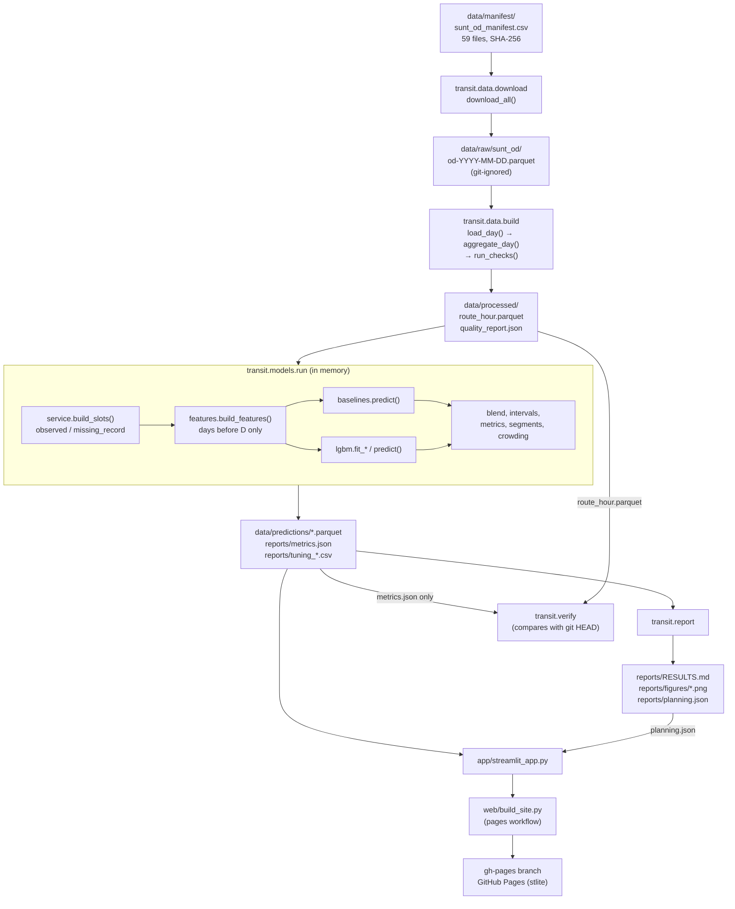

# Reference guide to the legacy implementation

CS3011 Artificial Intelligence, Group 52, PDPM IIITDM Jabalpur. Project: *AI Based Public Transport Demand and Occupancy Prediction*.

This is the main technical reference for the code in this repository. It explains what the existing system does, how each part works, which results it reported and how to check them. It is written for the five team members, who are redeveloping the project in a new repository under a human-led plan ([SCENARIO3_REDEVELOPMENT_GUIDE.md](SCENARIO3_REDEVELOPMENT_GUIDE.md)).

> **What this repository is.** The code and documents here were written in AI-assisted sessions (Claude, Anthropic), directed and reviewed by Jay; almost every commit carries a `Co-Authored-By` line (details in section [J.5](#j5-provenance-of-the-legacy-implementation)). It is a **reference implementation and a source of historical results**. It is not evidence of work done under Scenario 3, and it does not describe the new repository, [jayvaghela779/transit-demand-occupancy](https://github.com/jayvaghela779/transit-demand-occupancy), whose work has not been reviewed here.

**Described version:** `main` at commit `3d0440b` (26 Oct 2026). Every file path, function name and constant below was checked against that commit on 27–28 Oct 2026.

**How claims are labelled.**

| Label | Meaning |
| --- | --- |
| **Implemented** | Behaviour of the code at `3d0440b`, read from the source |
| **Historical result** | A number stored in the committed output files (`reports/metrics.json`, `reports/RESULTS.md`, `data/processed/quality_report.json`, `reports/planning.json`) |
| **Re-checked 27–28 Oct** | Re-executed during this review; the commands and outputs are in section [I.6](#i6-verification-record-2728-october-2026) |
| **Limitation** | A known weakness of the method, the data or the code |
| **Proposal** | An idea for the redevelopment. Not implemented here |

## Contents

- [A. Project overview](#a-project-overview)
- [B. System architecture](#b-system-architecture)
- [C. Code map](#c-code-map)
- [D. Dataset and preprocessing](#d-dataset-and-preprocessing)
- [E. Forecasting workflow](#e-forecasting-workflow)
- [F. Evaluation methodology](#f-evaluation-methodology)
- [G. Crowding and capacity analysis](#g-crowding-and-capacity-analysis)
- [H. Dashboard reference](#h-dashboard-reference)
- [I. Reproduction and verification](#i-reproduction-and-verification)
- [J. Limitations and lessons](#j-limitations-and-lessons)

Related documents: the decision log [DECISIONS.md](DECISIONS.md) (D1–D13), the data card [DATA.md](DATA.md), the generated results [reports/RESULTS.md](../reports/RESULTS.md), the issues found in this review [KNOWN_ISSUES.md](KNOWN_ISSUES.md), and the documentation index [docs/README.md](README.md).

---

## A. Project overview

### A.1 Problem and objective

Bus planners set frequencies and vehicle sizes before a service day starts. The legacy system forecasts, **before each service day**, how many passengers will board each bus route in each direction and hour, and how full the buses on that route-hour are likely to be, as estimated load. It compares a learned model (LightGBM) with simple baselines on held-out weeks, turns load forecasts into crowding levels under stated bus-capacity assumptions, and shows the results in a Streamlit dashboard.

### A.2 Prediction targets

| Target | Column | Unit | Definition (Implemented) |
| --- | --- | --- | --- |
| Demand | `boardings` | passengers per route-hour | Sum of SUNT `n-boardings` over all stop events of the route, direction and clock hour (`aggregate_day`, `src/transit/data/aggregate.py`) |
| Estimated load (the "occupancy" target) | `load_trip_peak_mean` | passengers on board | For each trip with a stop event in the hour, the highest SUNT `loading` value (estimated load after boardings) in that hour; then the mean over those trips. In words: a typical bus's peak estimated load in that hour |

### A.3 Prediction unit and horizon

- **Unit:** one route (`route_short_name`) × direction (`I` or `V`) × clock hour of a service day (decision D7). A service day runs from about 03:45 to about 02:15 the next morning, so the code uses `service_hour` = hours since the service date's midnight: 3–23 for the same calendar day and 24–26 for 00:00–02:00 the next morning (`add_calendar`, `src/transit/data/service.py`).
- **Horizon:** day-ahead. Before service day D starts (about 03:00), every route-hour slot of day D is forecast using only service days strictly before D (`src/transit/features.py`, module docstring). The models are not retrained day by day: validation forecasts come from models fit on the training weeks, and test forecasts from one refit on training plus validation. Only the inputs roll forward one day at a time.

### A.4 Data

Salvador Urban Network Transportation (SUNT), Salvador, Brazil, licensed CC BY 4.0. The system uses the daily origin-destination (OD) files for 1 March to 28 April 2024 (59 days), pinned to SUNT commit `f8d90fb38f3b1a6f74a18f0298d72fe0c6eaa54c` (`src/transit/config.py`) and checked with SHA-256 checksums (`data/manifest/sunt_od_manifest.csv`).

Attribution: Ferreira, M. V., Souza, M., Rios, T. N., Fernandes, I. F. C., Nery, J., Gama, J., Bifet, A. & Rios, R. A. (2025). *Salvador Urban Network Transportation (SUNT): A Landmark Spatiotemporal Dataset for Public Transportation.* Scientific Data 12, 1320. https://doi.org/10.1038/s41597-025-05674-6. Dataset: https://doi.org/10.17632/85fdtx3kr5.1.

### A.5 Demand, estimated load and measured occupancy are different things

| Quantity | Where it comes from | Status in this project |
| --- | --- | --- |
| **Passenger demand (boardings)** | Contactless fare-card validations matched to vehicles by SUNT | Observed, but under-counted: riders aged 65+ travel without cards, and unmatched validations are dropped or spread by SUNT |
| **Estimated on-board load** | SUNT infers alightings by trip chaining (a passenger's next boarding within walking distance) and computes load = earlier load + boardings − inferred alightings | **An estimate**, not a measurement. This is what the dashboard calls "occupancy" |
| **Directly measured occupancy** (passenger counters, manual counts) | Not in SUNT | **Not available.** The project never measured or validated it |

Everywhere in this guide, "load" means estimated on-board load.

### A.6 What the system produces

| Output | Path | Written by |
| --- | --- | --- |
| Route-hour table (541,611 rows × 12 columns, Historical result) | `data/processed/route_hour.parquet` | `python -m transit.data.build` |
| Data-quality report | `data/processed/quality_report.json` | same |
| Validation and test predictions per slot | `data/predictions/{demand,load}_{valid,test}.parquet` | `python -m transit.models.run` |
| Next-day demonstration forecast (29 Apr 2024, no actuals) | `data/predictions/forecast_2024-04-29.parquet` | same |
| All metrics, settings and segment results | `reports/metrics.json`; tuning tables `reports/tuning_{demand,load}.csv` | same |
| Trained models (not committed) | `models/{demand,load}_lgbm.txt` | same |
| Results write-up, figures and alert-list precision | `reports/RESULTS.md`, `reports/figures/*.png`, `reports/planning.json` | `python -m transit.report` |
| Dashboard | `app/streamlit_app.py` | `streamlit run app/streamlit_app.py` |
| Public static copy of the dashboard | `gh-pages` branch, https://jayvaghela779.github.io/cs3011-public-transport-demand-occupancy/ | `.github/workflows/pages.yml` running `web/build_site.py` |

### A.7 What the system does not establish

- That estimated loads equal real occupancy. Nothing here is checked against counted passengers.
- That the method works in Indian or tier-2 cities, or any city other than Salvador.
- How it behaves on holidays: Good Friday (29 Mar 2024) is in the training weeks and the test weeks contain no weekday holiday (D3).
- How it behaves in other seasons or years: the test window is two weeks.
- That the chosen capacities match the buses on each route: capacity is not in the data (D10).
- That an hour with no SUNT record had no service or no passengers (D8).
- Operational value: the daily alert list is an illustration, not a validated planning tool.
- Who wrote which part. The README's team table is a speaking split, not an authorship record.

---

## B. System architecture

Data flows one way. Each stage is a command or function whose output the next stage reads, so any stage can be rerun and its files compared.



### B.1 Stages, what they read and what they write

| # | Stage | Entry point | Reads | Writes |
| --- | --- | --- | --- | --- |
| 1 | Download | `python -m transit.data.download` → `download_all()` | `data/manifest/sunt_od_manifest.csv`; SUNT files from `raw.githubusercontent.com` at the pinned commit | `data/raw/sunt_od/od-*.parquet` (skips files whose size and SHA-256 already match) |
| 2 | Aggregate and check | `python -m transit.data.build` → `build()` | the 59 raw files | `data/processed/route_hour.parquet`, `data/processed/quality_report.json`; exits with status 1 if a quality check fails |
| 3 | Service slots | `build_slots()` in `src/transit/data/service.py`, called by `run.main()` | route-hour table | in memory: one row per modelling slot |
| 4 | Features | `build_features()` in `src/transit/features.py` | slots | in memory: one feature frame per target |
| 5 | Train, tune, score, forecast | `python -m transit.models.run` → `main()` → `run_target()` | route-hour table | predictions, `metrics.json`, tuning CSVs, `models/` |
| 6 | Report | `python -m transit.report` → `main()` | `metrics.json`, the test and validation prediction files | `RESULTS.md`, 5 figures, `planning.json`; stops if a test WAPE recomputed from predictions disagrees with `metrics.json` |
| 7 | Verify | `python -m transit.verify` → `main()` | working-tree `route_hour.parquet` and `metrics.json`, plus their versions in git `HEAD` | nothing; exit 0 if they match, 1 if not, 2 without a git clone |
| 8 | Dashboard | `streamlit run app/streamlit_app.py` | `metrics.json`, `planning.json`, the 5 prediction files | nothing |
| 9 | Publish | `.github/workflows/pages.yml` runs `python web/build_site.py OUT` on pushes to `main` that touch the app, `src/transit/`, results or `web/` | `web/index.html` and the files listed in its `FILES` constant | the `gh-pages` branch |

### B.2 Commands to reproduce the outputs, in order

```bash
python -m transit.data.download   # stage 1
python -m transit.data.build      # stage 2
python -m transit.models.run      # stages 3-5
python -m transit.report          # stage 6
python -m transit.verify          # stage 7
streamlit run app/streamlit_app.py
```

Section [I](#i-reproduction-and-verification) gives the full setup and what each command printed when it was rerun for this review.

### B.3 Module dependencies (imports)

```
transit.config  <-  every module below (paths, pinned source, split dates)
transit.data.manifest  <-  download, build, service, models.run
transit.data.aggregate <-  build
transit.data.service   <-  features (SLOT_KEYS), models.run (build_slots, REGULAR_SHARE, MIN_TRAIN_DAYS)
transit.features       <-  models.run
transit.models.baselines, transit.models.lgbm  <-  models.run
transit.metrics        <-  models.run, report, app
transit.crowding       <-  models.run, report (planning_topk), app
transit.models.run     <-  report (period_of only)
app/design.py          <-  app/streamlit_app.py (presentation only; reads no results)
```

The dashboard imports only `transit.crowding` and `transit.metrics` (and `metrics` loads scikit-learn lazily inside `classification_metrics`), so the public in-browser build does not need scikit-learn or LightGBM. `tests/test_web.py::test_app_modules_do_not_load_scikit_learn` checks this.

### B.4 Main functions and their responsibilities

| Function | Responsibility |
| --- | --- |
| `manifest.read_manifest`, `sha256_of`, `study_dates` | Read the pinned file list; hash a file; list the 59 study dates |
| `download.download_all`, `fetch` | Fetch each listed file with retries; reject a checksum mismatch |
| `aggregate.load_day` | Read the 8 SUNT columns needed, rename them, set types; unparseable `stop_time` becomes NaT |
| `aggregate.malformed_trip_ids` | Trips that repeat a stop sequence number (D9) |
| `aggregate.aggregate_day` | Drop events outside the 30-hour window, group to route × direction × clock hour, compute the 8 measures and per-day quality statistics |
| `build.run_checks`, `build.build` | Six quality checks; write the table and report |
| `service.add_calendar`, `daytype` | Service hour, day of week, day type (weekday, Saturday, Sunday, holiday) |
| `service.service_profile`, `in_scope_route_directions`, `build_slots` | Training-only regular-service profile (D8), scope rule, slot table with `status` and `load_reliable` |
| `features.target_series`, `build_features`, `model_feature_names` | Observed target (NaN where unusable); leak-free feature frame; the model's feature list |
| `baselines.hour_medians`, `baselines.predict` | Training medians per hour; baseline predictions with a recorded fallback source |
| `lgbm.fit_with_early_stopping`, `fit_fixed_rounds`, `predict` | LightGBM training on train with early stopping on validation; refit for a fixed number of rounds; non-negative predictions |
| `run.split_of`, `period_of`, `run_target`, `main` | Assign splits; label periods of day; the whole protocol for one target; write all outputs |
| `metrics.regression_metrics`, `classification_metrics` | MAE, RMSE, WAPE, bias; accuracy, macro-F1, per-class precision/recall/F1, confusion matrix |
| `crowding.crowding_level`, `level_shares` | Load factor → low/medium/high; class shares |
| `report.recompute_check`, `bootstrap_wape_diff`, `coverage_by_segment`, `planning_topk`, `main` | Consistency check; paired cluster bootstrap; interval coverage by segment; daily top-K alert precision; RESULTS.md and figures |
| `verify.flatten`, `differences`, `table_differences`, `main` | Compare a rerun's table and metrics with the committed versions |

---

## C. Code map

Commands assume the repository root as the working directory and the package installed with `pip install -e .`.

| File | Responsibility | Inputs → outputs | Important names | Tests | Inspect or run |
| --- | --- | --- | --- | --- | --- |
| `src/transit/config.py` | Paths, pinned SUNT commit and URL, study dates, split dates | none | `ROOT`, `SUNT_COMMIT`, `SUNT_RAW_URL`, `START_DATE`, `END_DATE`, `TRAIN_END`, `VALID_END` | `test_config.py` | `python -c "from transit import config; print(config.TRAIN_END, config.VALID_END)"` |
| `src/transit/data/manifest.py` | Pinned file list and hashing; maintainer-only manifest writer | manifest CSV → list of dicts | `read_manifest`, `write_manifest`, `sha256_of`, `study_dates`, `od_filename` | `test_pipeline_e2e.py::test_manifest_round_trip` | `python -m transit.data.manifest --help` |
| `src/transit/data/download.py` | Verified download | manifest → `data/raw/sunt_od/` | `download_all`, `fetch` | `test_pipeline_e2e.py::test_download_verifies_and_skips`, `::test_download_rejects_checksum_mismatch` | `python -m transit.data.download --limit 3` |
| `src/transit/data/aggregate.py` | Stop events → route-hours; burst and malformed-trip flags | one raw day → route-hour rows + stats | `RAW_COLUMNS`, `KEYS`, `BURST_BOARDINGS = 100.0`, `WINDOW_HOURS = 30`, `load_day`, `malformed_trip_ids`, `aggregate_day` | `test_aggregate.py`, `test_inputs_and_time.py` | `pytest tests/test_aggregate.py -q` |
| `src/transit/data/build.py` | 59-day build and quality checks | raw files → `route_hour.parquet`, `quality_report.json` | `run_checks`, `build`, `CONSERVATION_TOL = 1e-9` | `test_aggregate.py::test_checks_*`, `test_pipeline_e2e.py`, `test_processed.py` | `python -m transit.data.build` |
| `src/transit/data/service.py` | Calendar, service profile, slots, scope (D8, D9) | route-hour table → slots | `HOLIDAYS`, `REGULAR_SHARE = 0.8`, `MIN_TRAIN_DAYS = 10`, `SLOT_KEYS`, `add_calendar`, `service_profile`, `in_scope_route_directions`, `build_slots` | `test_service.py` | `pytest tests/test_service.py -q` |
| `src/transit/features.py` | Day-ahead features without future information | slots → feature frame | `LAGS = [1, 7, 14, 21, 28]`, `target_series`, `build_features`, `model_feature_names` | `test_features_and_baselines.py` (includes the leakage test) | `pytest tests/test_features_and_baselines.py -q` |
| `src/transit/models/baselines.py` | Three baselines with a fixed fallback chain | feature frame → predictions + source | `PRIMARY`, `FALLBACKS`, `hour_medians`, `predict` | `test_features_and_baselines.py::test_baseline_fallback_chain_covers_every_row` | same |
| `src/transit/models/lgbm.py` | LightGBM parameters, grid and training | feature frames → boosters, predictions | `BASE_PARAMS`, `GRID`, `MAX_ROUNDS = 3000`, `EARLY_STOP = 100`, `fit_with_early_stopping`, `fit_fixed_rounds`, `predict` | `test_models_run.py` | `pytest tests/test_models_run.py -q` |
| `src/transit/models/run.py` | Full protocol: tuning, ablation, refit, blend, intervals, test scoring, error analysis, crowding, next-day forecast | route-hour table → predictions, `metrics.json`, tuning CSVs, `models/` | `TARGETS`, `BASELINES`, `BLEND_WEIGHTS`, `QUANTILES`, `NOMINAL`, `PERIODS`, `split_of`, `period_of`, `crowding_results`, `run_target`, `main` | `test_models_run.py` (synthetic fixture), `test_app.py` (committed outputs) | `python -m transit.models.run` |
| `src/transit/metrics.py` | Regression and classification metrics | arrays → dict | `regression_metrics`, `classification_metrics` | `test_features_and_baselines.py::test_regression_metrics_known_values`, `::test_crowding_levels_and_scenarios` | `pytest -k metrics -q` |
| `src/transit/crowding.py` | Capacity scenarios and crowding levels (D10) | loads → levels | `BASE_CAPACITY = 70`, `CAPACITY_SCENARIOS`, `THRESHOLDS = (0.5, 0.8)`, `LEVELS`, `SOURCE`, `crowding_level`, `level_shares` | `test_features_and_baselines.py::test_crowding_levels_and_scenarios` | `pytest -k crowding -q` |
| `src/transit/report.py` | RESULTS.md, figures, bootstrap, coverage, alert precision | `metrics.json`, predictions → `RESULTS.md`, figures, `planning.json` | `recompute_check`, `bootstrap_wape_diff`, `coverage_by_segment`, `planning_topk`, `main` | `test_app.py::test_planning_precision_matches_prediction_files`, `::test_report_coverage_by_period_agrees_with_metrics` | `python -m transit.report` |
| `src/transit/verify.py` | Compare a rerun with git `HEAD` | table + metrics → exit status | `VOLATILE`, `TOLERANCE = 1e-6`, `flatten`, `differences`, `table_differences`, `main` | `test_verify.py` | `python -m transit.verify` |
| `app/streamlit_app.py` | Five-page dashboard | metrics, planning, predictions → web page | `PAGES`, `page_explorer`, `page_comparison`, `page_crowding`, `page_forecast`, `page_data`, `day_chart`, `metrics_table` | `test_app.py` | `streamlit run app/streamlit_app.py` |
| `app/design.py` | Colours, bundled fonts, CSS, chart template, HTML table helpers | none (presentation only) | `stylesheet`, `figure`, `table`, `figures`, `crowding_strip` | `test_app.py::test_design_stylesheet_embeds_the_fonts`, `test_web.py::test_theme_matches_between_local_app_and_public_build` | see [DESIGN.md](DESIGN.md) |
| `web/index.html`, `web/build_site.py`, `web/wheels.txt` | Public in-browser build (stlite) | listed files → `gh-pages` | `FILES`, `WHEELS`, `build`, `download_wheels` | `test_web.py` | `python web/build_site.py /tmp/site --no-wheels` |
| `.github/workflows/tests.yml` | CI: tests and `transit.verify` on Ubuntu (3.11, 3.12) and Windows (3.12, normal and locked requirements) | repository → pass/fail | | | GitHub Actions tab |
| `notebooks/reproduce_on_colab.ipynb` | The pipeline commands in a notebook | | | not executed by CI or in this review; no recorded run | open in Colab |

---

## D. Dataset and preprocessing

### D.1 Provenance and licence

- **Source files:** `data/od/od-YYYY-MM-DD.parquet` in https://github.com/LabIA-UFBA/SUNT at commit `f8d90fb38f3b1a6f74a18f0298d72fe0c6eaa54c`, downloaded from `https://raw.githubusercontent.com/LabIA-UFBA/SUNT/<commit>/data/od/<file>` (`config.SUNT_RAW_URL`).
- **Pinning:** `data/manifest/sunt_od_manifest.csv` holds the date, file name, size and SHA-256 of each of the 59 files. `download_all` deletes a file and raises an error if its hash differs.
- **Licence:** the dataset is CC BY 4.0 (checked on 24 Oct 2026 on the GitHub README, the Mendeley record and the Hugging Face card, per [DATA.md](DATA.md)). The article has its own licence and is cited, not reproduced. Raw files are git-ignored (`data/raw/`); the committed derived files say what was changed ([data/processed/README.md](../data/processed/README.md)). The licence was not re-checked in this review.

### D.2 Columns used

`load_day` reads only these SUNT columns (`RAW_COLUMNS`) and renames the hyphenated ones:

| SUNT column | Renamed to | Meaning | Type after loading |
| --- | --- | --- | --- |
| `route_short_name` | `route` | Route code | string |
| `direction_id` | `direction` | `I` or `V` | string |
| `trip_id` | `trip_id` | Trip identifier | string |
| `pt_sequence` | `pt_sequence` | Stop sequence number within the trip | as stored |
| `stop_time` | `stop_time` | Time of the stop event (local Salvador time, no time zone) | datetime; unparseable values become NaT |
| `n-boardings` | `n_boardings` | Boardings at this stop; can be fractional | float |
| `n-alighting` | `n_alighting` | **Inferred** alightings | float |
| `loading` | `loading` | **Estimated** load after boardings | float |

Other SUNT columns (for example `lag_loading`, `balance`, stop and vehicle identifiers) are not used. `tests/test_inputs_and_time.py::test_categorical_sunt_types_give_same_result_as_strings` checks that categorical source types give the same result.

### D.3 Timestamps and service hours

- A file's date is its **service date**. `aggregate_day` keeps stop events in `[service_date 00:00, service_date + 30 h)` (`WINDOW_HOURS = 30`) and counts the rest as timestamp errors in the quality report. Events with NaT `stop_time` fall outside the window. The end of the window is exclusive (`test_window_end_is_exclusive`).
- `ts_hour` is `stop_time` floored to the clock hour. An event at 00:30 the next morning keeps its own clock hour (`test_after_midnight_events_keep_their_clock_hour`).
- `service_hour` (24–26 for 00:00–02:00 of the next calendar day) is computed later, in `add_calendar`.
- No time-zone conversion is done; all times are as stored by SUNT.

### D.4 Aggregation (one row per route, direction and clock hour)

| Column | Computation in `aggregate_day` |
| --- | --- |
| `service_date`, `route`, `direction`, `ts_hour` | Keys; `(route, direction, ts_hour)` must be unique across the whole table |
| `boardings` | Sum of `n_boardings` |
| `alightings` | Sum of `n_alighting` (inferred) |
| `n_stop_events` | Number of stop events |
| `n_trips` | Distinct `trip_id` |
| `load_max` | Maximum `loading` over the hour's stop events |
| `load_trip_peak_mean` | Per trip, maximum `loading` in the hour; then the mean over trips (**the load target**) |
| `n_burst_events` | Stop events with `n_boardings > 100` (`BURST_BOARDINGS`); counted, never removed (D11) |
| `n_malformed_trips` | Trips in the hour that repeat a `pt_sequence` (D9) |

Nothing is capped, imputed or edited. Hours with no stop event produce **no row**.

### D.5 Quality checks (`run_checks` in `build.py`)

| Check | Passes when | Historical result (and Re-checked 27–28 Oct) |
| --- | --- | --- |
| `unique_route_direction_hour` | no duplicate `(route, direction, ts_hour)` | 0 duplicates |
| `all_service_days_present` | every requested day has rows | 59 of 59 |
| `boardings_conserved` | raw and aggregated boardings agree to a relative 1e-9 per day | largest difference 0 |
| `no_negative_aggregated_values` | no negative `boardings`, `alightings`, `load_max`, `load_trip_peak_mean` | 0 (1 negative raw stop-event value, inside a malformed trip) |
| `malformed_trips_rare` | malformed trips ≤ 0.1% of trips | 222 of 1,168,044 (0.019%) |
| `few_events_outside_window` | boardings outside the window ≤ 0.01% | 0 events |

`build` exits with status 1 if any check fails. Summary of the committed build (Historical result, `quality_report.json`): 37,600,997 stop events; 541,611 route-hour rows; 410 routes and 713 route-directions; 51,353,180 boardings; 2,685 burst events; 340 route-hours with no load value; highest single estimated load 469.6 passengers.

### D.6 Missing observations (decision D8)

An absent route-hour can mean "no bus was scheduled" or "a bus ran but SUNT has no record". SUNT's timetable covers 21 May–21 Jun 2024, so it cannot separate the two for March–April. The code therefore never fills absent hours with zero. `build_slots` does this (Implemented):

1. **Scope:** route-directions observed on at least 10 training days (`MIN_TRAIN_DAYS`). 38 of 713 route-directions (1,160 rows) are out of scope (D8, Historical result).
2. **Service profile from training days only** (`service_profile`): a cell (route, direction, day type, service hour) is *regular* if observed on at least 80% (`REGULAR_SHARE`) of training days of that day type.
3. **Slots:** every observed row (`status = "observed"`, including real zeros: 22,674 rows with zero boardings) plus every regular cell with no row on a day (`status = "missing_record"`). Absent hours in non-regular cells get no slot and are not predicted.
4. Missing records are predicted (the dashboard shows them as open circles) but have NaN target, are NaN inside lag features, and are **never scored**.

| Slot kind (Historical result) | Train | Validation | Test |
| --- | --- | --- | --- |
| Observed, scored for demand | 348,243 | 64,273 | 127,935 |
| Missing record (predicted, never scored) | 3,309 | 1,060 | 2,797 |

**Why it matters.** Zero-filling would invent passenger-free hours, make the test set easier, and teach the model that gaps are zero demand. The forecast is therefore "boardings in this hour, given that the route runs".

### D.7 Malformed trips and the load target (decision D9)

222 trips (all on 2–3 Apr 2024, route-directions 1235 I, 1246 V and 1383 V) repeat stop sequence numbers, so SUNT's load chain is broken for them. They stay in the table, flagged by `n_malformed_trips`. In `build_slots`, `load_reliable` is True only for observed rows with a non-missing `load_trip_peak_mean` and no malformed trip. `features.target_series` sets the load target to NaN where `load_reliable` is False. In practice those three route-directions are also out of scope (fewer than 10 training days).

The load target therefore has slightly fewer scored rows than demand: 348,022 / 64,239 / 127,855 for train / validation / test (Historical result).

### D.8 Known data limitations

- Estimated, not measured, load (A.5).
- Riders aged 65+ are missing; demand and load are under-counted. A rough external check in [DATA.md](DATA.md) puts SUNT weekday boardings at about 85% of a published city figure (a sanity check, not a reconciliation).
- 2 Apr 2024 looks like a partial outage (18 regular route-directions with no records).
- Burst validations: 2,685 stop events with more than 100 boardings, 99.8% at 10 stops at the first stop of a trip (D11). They inflate loads at terminals; the highest load (469.6) is far above any bus capacity.
- No vehicle capacity in the data.
- One city, 59 days, one season.

---

## E. Forecasting workflow

### E.1 Features (`build_features`, Implemented)

All features for day D come from service days strictly before D. Values from missing records and non-service hours are NaN, never 0. A *cell* is route × direction × service hour.

| Feature | Definition |
| --- | --- |
| `route`, `direction` | Categorical identifiers (LightGBM categorical features) |
| `service_hour`, `dow`, `is_weekend`, `is_holiday`, `lag7_was_holiday` | Calendar; `lag7_was_holiday` is True if D−7 was a holiday |
| `y_lag1`, `y_lag7`, `y_lag14`, `y_lag21`, `y_lag28` | Target in the same cell 1, 7, 14, 21, 28 service days earlier |
| `y_mean_dow4` | Mean of `y_lag7..y_lag28` (last four same weekdays), skipping NaN |
| `y_roll7` | Mean of the same cell over the previous 7 days, skipping NaN |
| `y_hist_daytype` | Expanding mean of all earlier observed values in the same cell and day type |
| `trips_lag7`, `trips_mean_dow4` | Observed trip counts 7 days earlier and over the last four same weekdays (a stand-in for the timetable) |
| `rd_total_lag1`, `rd_total_lag7` | Route-direction daily demand total 1 and 7 days earlier |
| `boardings_lag7`, `boardings_mean_dow4` | Load target only: earlier demand in the same cell |

Demand uses 19 features and load 21 (`model_feature_names`). The feature frame also carries `target`, `status`, `regular`, `daytype` and `n_burst_events` for evaluation; they are not model inputs.

**Leakage test:** `tests/test_features_and_baselines.py::test_features_for_day_d_ignore_day_d_and_later` multiplies every value from day D onward by 50 and checks that day D's features are unchanged while its target changed.

### E.2 Baselines (`src/transit/models/baselines.py`)

| Name in code | Report name | Primary rule |
| --- | --- | --- |
| `seasonal_naive` | Same hour last week | `y_lag7` |
| `dow4_mean` | Mean of last 4 same weekdays | `y_mean_dow4` |
| `hist_average` | Historical average (same day type and hour) | `y_hist_daytype` |

If the primary value is NaN, each baseline falls back to `y_hist_daytype`, then `y_roll7`, then the training-period median for that service hour (`hour_medians`). Every scored row therefore gets a prediction, and the source of each prediction is recorded in `metrics.json` under `baseline_fallbacks`. Example (demand, test, Historical result): `seasonal_naive` used `y_lag7` for 126,281 of 127,935 rows, the historical average for 1,539, `y_roll7` for 48 and the hour median for 67.

Validation baselines use training medians; test baselines use train + validation medians.

### E.3 LightGBM (`src/transit/models/lgbm.py`)

- **Fixed parameters** (`BASE_PARAMS`): learning rate 0.05, `min_data_in_leaf` 50, feature and bagging fraction 0.8, L2 1.0, `seed` 42, `deterministic=True`, 2 threads; validation metric L1.
- **Grid** (`GRID`), six configurations per target: L2, L1, Poisson, Tweedie (demand) or Huber (load), with 63 or 255 leaves.
- **Training:** up to 3,000 rounds with early stopping after 100 rounds without validation improvement.
- **Predictions** are clipped at 0.

### E.4 Model selection, refit and the final forecast (`run_target`)

1. Fit every grid configuration on **train** with early stopping on **validation**; keep the lowest validation WAPE. Chosen (Historical result): L1 objective, 63 leaves, 130 rounds for demand and 140 rounds for load.
2. Feature-group ablation on validation (calendar + route only; + same-hour history; all features).
3. Refit the chosen configuration on **train + validation** for the same number of rounds (`fit_fixed_rounds`); this model makes the test predictions.
4. **Blend (D12):** `ensemble = w × LightGBM + (1 − w) × historical average`, with `w` chosen on validation from `BLEND_WEIGHTS = [0, 0.25, 0.5, 0.75, 1]`. `w = 0.5` for both targets.
5. **80% intervals (D13):** quantile LightGBM models (α = 0.1 and 0.9) early-stopped on validation and refit on train + validation, then widened by a split-conformal margin from validation. In the committed run the margin was 0.00026 for demand and 0.0 for load, so this "calibration" step changed almost nothing.
6. **Next-day forecast:** the same blend and intervals for 29 Apr 2024 (9,566 slots), the day after the data ends. There are no actuals, so it is not evaluated.

**Trade-offs, stated plainly.** Almost all of the model's split gain sits on `y_hist_daytype` (72.94% for demand; Historical result), which is the historical-average baseline itself. LightGBM alone was only slightly better than that baseline on validation (demand WAPE 18.84% against 18.99%) and slightly worse on test (18.39% against 18.35%); the blend is what makes the small test gain (section F.6). The validation week is used for early stopping, configuration choice, ablation, the blend weight and the interval margin, so validation scores are optimistic. Six configurations is a small grid. The blend was introduced after the first test scoring (D12).

### E.5 Prediction files

`data/predictions/{demand,load}_{valid,test}.parquet` have one row per slot with: `route`, `direction`, `service_date`, `service_hour`, `ts_hour`, `daytype`, `status`, `regular`, `n_burst_events`, `target` (NaN for missing records), `ensemble`, `model` (LightGBM alone), `lo`, `hi`, `seasonal_naive`, `dow4_mean`, `hist_average`. The forecast file has `demand_forecast`, `demand_lo`, `demand_hi`, `load_forecast`, `load_lo`, `load_hi` per slot.

---

## F. Evaluation methodology

### F.1 Chronological split (`config.py`, decision D3)

| Split | Dates (2024) | Purpose |
| --- | --- | --- |
| Train | 1 Mar – 7 Apr (38 days) | Fit models; compute the service profile, scope and baseline medians |
| Validation | 8 – 14 Apr (7 days) | Every choice: early stopping, configuration, ablation, blend weight, interval margin |
| Test | 15 – 28 Apr (14 days) | Final scoring |
| Forecast demo | 29 Apr | Unscored next-day forecast |

29–30 Apr 2024 files are excluded because they cover noticeably fewer routes (`config.py` comment). The split is by date, never random.

### F.2 How leakage is prevented (Implemented)

- Features for day D use only days before D (E.1), enforced by the leakage test.
- The service profile and the scope rule use training days only (`test_profile_uses_training_days_only`). The baselines' last-resort hour medians use only data before the scored period: the training weeks for validation, training plus validation for test.
- Validation predictions come from the model trained on train only; test predictions from the model refit on train + validation, with no further tuning.
- During the test weeks the model is fixed, but its inputs use actuals from earlier test days, as a real day-ahead forecaster would.

### F.3 Metrics (exact definitions in `src/transit/metrics.py`)

For scored actuals y and predictions ŷ (n rows; `regression_metrics` raises `ValueError` if either contains NaN):

- MAE = mean(|ŷ − y|)
- RMSE = sqrt(mean((ŷ − y)²))
- WAPE = Σ|ŷ − y| / Σ|y|; NaN if Σ|y| = 0. Lower is better; it is error per passenger, not a per-row percentage. WAPE is used rather than MAPE because 5,165 observed test hours have zero boardings.
- Bias = mean(ŷ − y); negative means under-forecasting.
- Crowding: accuracy, macro-F1 (unweighted mean of the per-class F1 for low, medium, high), per-class precision/recall/F1 with `zero_division=0`, and the confusion matrix (scikit-learn).
- Intervals: coverage = share of actuals with lo ≤ y ≤ hi; mean width.

### F.4 Comparable observations

In `run_target`, the scored rows are `X["target"].notna()` within each split. Every method (blend, LightGBM alone and the three baselines) is scored on exactly these rows, which is why every row of a results table has the same `n` (127,935 for demand and 127,855 for load on test). Missing records and out-of-scope route-directions are never scored. `tests/test_app.py::test_missing_records_are_never_scored` and `::test_reported_test_metrics_match_prediction_files` check this against the committed files.

### F.5 Uncertainty and error analysis (Implemented)

- **Paired cluster bootstrap** (`report.bootstrap_wape_diff`): 2,000 resamples of route-directions with replacement (seed 0) of the WAPE difference between two methods; 2.5% and 97.5% quantiles give a 95% interval. It reflects variation across routes within the same two weeks, not across weeks or seasons.
- **Segments** (`run_target`): WAPE by period of day (`PERIODS`), day type, route-volume tercile (from training means), regular vs non-regular cell, test day, the 10 route-directions with the largest total error, zero-actual hours, and (load) hours with and without burst events.
- **Interval coverage by segment** (`report.coverage_by_segment`).

### F.6 Historical results (test weeks 15–28 Apr 2024)

From `reports/metrics.json` and `reports/RESULTS.md`. These are the legacy implementation's numbers; a new implementation must compute its own.

| Method | Demand WAPE | Demand MAE | Demand RMSE | Load WAPE | Load MAE |
| --- | --- | --- | --- | --- | --- |
| Final: 0.5 × LightGBM + 0.5 × historical average | 18.15% | 17.86 | 29.72 | 19.20% | 4.69 |
| LightGBM alone | 18.39% | 18.10 | 31.34 | 19.39% | 4.74 |
| Historical average | 18.35% | 18.06 | 29.58 | 19.35% | 4.73 |
| Mean of last 4 same weekdays | 20.75% | 20.42 | 33.64 | 21.45% | 5.24 |
| Same hour last week | 23.67% | 23.30 | 37.93 | 25.39% | 6.21 |

- **Gain over the historical average is small:** −0.20 WAPE points for demand (95% bootstrap interval −0.29 to −0.06); the blend has lower WAPE on 13 of 14 test days for demand and 12 of 14 for load.
- **On RMSE the historical average is better for demand** (29.58 against 29.72). The gain is in absolute error only.
- **LightGBM alone did not beat the historical average on test** (18.39% against 18.35%), after being only slightly better on validation (18.84% against 18.99%).
- **80% intervals:** coverage 80.39% (demand) and 79.30% (load) overall, but only 52.11% for load at night (00:00–02:00; 49.86% on validation).
- **Validation week** (optimistic, used for selection): blend 18.65%, LightGBM 18.84%, historical average 18.99%, last week 25.68% (demand WAPE).

### F.7 How many times the test weeks were scored (D12)

The first full run scored LightGBM alone on test (kept in `reports/archive/metrics_v1_lightgbm_only.json`). Seeing it tie the historical average, the authors tried two ideas on validation only (`reports/archive/experiments_validation_v2.*`), introduced the blend, chose its weight on validation and scored test a second time. Both scorings are disclosed in `metrics.json` (`test_scoring_history`) and RESULTS.md. The blend was motivated by a test result, so the test weeks are not untouched.

### F.8 Historical methodology versus proposals

Everything in F.1–F.7 is what the legacy code does. The following are **Proposals** for the redevelopment, not implemented: fix the protocol and the number of test scorings before any test evaluation; keep a separate calibration week or use rolling-origin evaluation over several weeks; report a baseline-versus-model comparison with RMSE and WAPE side by side from the start; calibrate intervals per period of day on validation if intervals are kept.

---

## G. Crowding and capacity analysis

### G.1 Interpretation

Crowding is computed from `load_trip_peak_mean`, the estimated peak load of a typical bus in the route-hour (A.2). It is an estimate from fare cards; a "high" label means the estimated load is high relative to an **assumed** capacity, not that a bus was observed to be full.

### G.2 Load factor and thresholds (`src/transit/crowding.py`, verified against the code)

`LF = estimated load / capacity`, then:

| Level | Condition |
| --- | --- |
| low | LF < 0.5 |
| medium | 0.5 ≤ LF < 0.8 |
| high | LF ≥ 0.8 |

`crowding_level` returns `None` for NaN loads. Boundary values are tested: at capacity 70, loads 34.9 → low, 35 → medium, 55.9 → medium, 56 → high (`test_crowding_levels_and_scenarios`). The function does **not** validate capacity: zero, negative or NaN capacities are not rejected (Limitation; see [KNOWN_ISSUES.md](KNOWN_ISSUES.md)).

### G.3 Capacity assumptions and their source

| Scenario key | Vehicle class | Capacity (passengers) |
| --- | --- | --- |
| `midionibus` | Midiônibus | 40 |
| `basico` | Ônibus básico (base case, `BASE_CAPACITY`) | 70 |
| `padron` | Padron | 80 |
| `articulado` | Articulado | 100 |

The code cites "ABNT NBR 15570:2009, Table 1 (minimum capacity by vehicle class) and Table 2 (6 standing passengers per m²)" (`crowding.SOURCE`, decision D10). This review did **not** re-check these values against the standard itself, which is not freely available. The capacity owner in the redevelopment must check the source or record the values as declared assumptions.

### G.4 Sensitivity analysis (Historical result, test weeks, final forecast)

`run.crowding_results` recomputes levels for actuals and every method under each capacity, on the same scored load rows.

| Capacity | Actual low / medium / high | Macro-F1: final | last week | historical average | "High": precision / recall (final) |
| --- | --- | --- | --- | --- | --- |
| 40 | 45.5% / 26.3% / 28.2% | 0.772 | 0.708 | 0.771 | 0.847 / 0.787 |
| 70 (base) | 76.6% / 18.2% / 5.2% | 0.769 | 0.713 | 0.766 | 0.786 / 0.610 |
| 80 | 83.2% / 14.3% / 2.6% | 0.751 | 0.701 | 0.748 | 0.782 / 0.498 |
| 100 | 91.7% / 7.8% / 0.5% | 0.683 | 0.663 | 0.686 | 0.773 / 0.250 |

What changes with capacity: the share of "high" hours (28.2% to 0.5%) and recall for "high" (0.79 to 0.25). What stays roughly stable: precision for "high" (about 0.77–0.85). The historical average is about as good as the final forecast in every scenario.

### G.5 Planning view: daily top-K alerts (`report.planning_topk`, `reports/planning.json`)

Each test day, take the K route-hours with the highest forecast load and measure the share that were actually "high" at capacity 70; average over the 14 days. Top-50: final 92.1%, historical average 91.4%, last week 78.6% (Historical result). The practical gain is over the last-week rule, not over a good average. This is an illustration, not a validated operational tool.

### G.6 Limitations

Assumed capacity, unknown fleet mix per route, estimated loads, burst validations at terminals, and a load target that averages trips within the hour (a single overloaded trip is diluted). Decision D5 ("extra trips needed") was left optional and is not implemented.

---

## H. Dashboard reference

### H.1 Starting it locally

```bash
pip install -r requirements.txt
pip install -e .            # optional for the app, which adds src/ to its path itself
streamlit run app/streamlit_app.py      # or: python -m streamlit run app/streamlit_app.py
```

It opens at http://localhost:8501. It reads only committed files (`reports/metrics.json`, `reports/planning.json`, `data/predictions/*.parquet`), so it needs no SUNT download and works offline. Data loading is cached with `st.cache_data`.

### H.2 Pages (`PAGES` in `app/streamlit_app.py`)

| Page | Shows | Data source | User controls and their effect |
| --- | --- | --- | --- |
| **Forecast explorer** (`page_explorer`) | For one route-direction and day: boardings that day (observed hours), the final forecast's and last week's WAPE for that day; hourly boardings chart (actual, final forecast, last week, 80% band, open circles for missing records); estimated-load chart with dashed medium/high lines; crowding strip (actual against forecast) | `demand_{test,valid}.parquet`, `load_{test,valid}.parquet`, interval coverage from `metrics.json` | Period (test or validation) switches files; route-direction list is sorted by total demand in that period; service day; capacity slider moves the dashed lines and recomputes both strips with `crowding_level` (the forecast itself does not change) |
| **Model comparison** (`page_comparison`) | Test tables for demand and load (MAE, RMSE, WAPE, bias, change against last week, rows); an expander that recomputes every test WAPE from the prediction files and marks Match or Differs; WAPE by time of day, route volume and test day; worst route-directions; tuning table, ablation and feature importance | `metrics.json`; `*_test.parquet` for the recompute check | "Error breakdown for" switches demand/load |
| **Crowding and capacity** (`page_crowding`) | Table for all four capacities (actual class shares, macro-F1 of three methods, precision/recall for "high"); confusion matrix; burst-hour comparison | `metrics.json` (`crowding_test`, `segments_test.burst_hours`) | Scenario selector for the confusion matrix |
| **Next-day forecast** (`page_forecast`) | A notice that this is a demonstration, not an evaluated result; number of route-hours forecast and of high-crowding hours; top-50 alert precision from the test weeks; the 25 highest-load hours; one route through the day | `forecast_2024-04-29.parquet`, `planning.json` | Capacity slider (recomputes levels); route-direction selector |
| **Data and limitations** (`page_data`) | Source, split, what occupancy means, missing hours, malformed trips, burst validations, capacity, interval gap | `metrics.json` (split dates); the rest is fixed text | none |

### H.3 Checking that the dashboard agrees with the stored outputs

- Automated: `pytest tests/test_app.py -q` renders all five pages with Streamlit's `AppTest`, exercises the widgets, and checks that metrics, interval coverage and alert precision match the prediction files.
- In the app: open **Model comparison → "Check: recompute the test metrics from the committed prediction files"**. All ten rows should show Match.
- By hand (Historical result, also seen in the app during this review, section I.6): Forecast explorer, test period, route `137 · I`, Wed 17 Apr 2024 → 8,760 boardings, final WAPE 15.3%, last-week WAPE 7.7%; Next-day forecast at capacity 70 → 9,566 route-hours forecast, 481 high.

### H.4 Known operational limitations

- The app has no friendly error page: if `metrics.json` or a prediction file is missing, Streamlit shows a Python exception ([KNOWN_ISSUES.md](KNOWN_ISSUES.md)).
- The public GitHub Pages copy runs Python in the visitor's browser: a first visit downloads about 85–89 MB (83 s at 10 Mbit/s, about 5 min 40 s at 2 Mbit/s, measured 24 Oct 2026). The local app is the dependable demo path ([DEMO_RUNBOOK.md](DEMO_RUNBOOK.md)).
- The public copy is rebuilt only by the pages workflow on `main`; editing `gh-pages` by hand is not supported.
- The report's dashboard screenshot (`reports/project_report/figures/dashboard_explorer.png`) predates the redesign merged in PR #15; the numbers are the same, the look is not.

---

## I. Reproduction and verification

### I.1 Environment

- Python 3.10 or newer (`pyproject.toml`). CI uses 3.11 and 3.12; the committed results were produced on Linux with Python 3.13.
- `requirements.txt` gives minimum versions; `requirements-lock.txt` pins the exact versions that reproduced the results from a fresh clone on 24 Oct 2026 (Python 3.12.3).
- `git` is needed for `transit.verify`, which compares with the committed files.

```bash
git clone https://github.com/jayvaghela779/cs3011-public-transport-demand-occupancy.git
cd cs3011-public-transport-demand-occupancy
python -m venv .venv
source .venv/bin/activate              # Windows PowerShell: .\.venv\Scripts\Activate.ps1
python -m pip install -r requirements.txt      # or requirements-lock.txt for the exact versions
python -m pip install -e .
```

### I.2 Tests

```bash
python -m pytest -q
```

98 tests in 11 files on `3d0440b` (Re-checked 27–28 Oct). Earlier documents quote 77, 86 or 93 tests: those were the counts on the dates they were written (PRs #15 and #16 added tests for the redesigned dashboard). The tests use small hand-written fixtures in the SUNT format, except `test_processed.py` and `test_app.py`, which check the committed outputs.

### I.3 Data pipeline, training, evaluation and report

```bash
python -m transit.data.download   # 59 files, about 510 MB; skips files already verified
python -m transit.data.build      # route-hour table and quality report
python -m transit.models.run      # tuning, refit, test scoring, intervals, forecast
python -m transit.report          # RESULTS.md, figures, planning.json
```

Each step overwrites the committed outputs in your working copy. Run them in a separate clone or worktree if you want to keep your copy clean; `git status` shows what changed.

### I.4 What `transit.verify` checks, and what it does not

`python -m transit.verify` compares the working-tree `data/processed/route_hour.parquet` cell by cell, and every number in `reports/metrics.json` (except wall-clock times), with their versions in git `HEAD`, at a relative tolerance of 1e-6.

- **After a full rerun** (I.3), a pass shows that the pipeline reproduced the committed table and metrics.
- **On a fresh clone without a rerun**, it compares the committed files with themselves and always passes. That is what the CI step "Committed results are self-consistent" does. It confirms the files load, not that the results reproduce.
- It does **not** compare the prediction files, `RESULTS.md`, `planning.json` or the figures. `transit.report` separately stops if test WAPEs recomputed from the prediction files disagree with `metrics.json`, and `tests/test_app.py` checks several numbers against the prediction files.

### I.5 Report and dashboard

```bash
python -m transit.report
streamlit run app/streamlit_app.py
```

The project report's Word and PDF files are rebuilt from their Markdown source with `python reports/project_report/build_report.py` (needs pandoc, python-docx and, for the PDF, LibreOffice).

### I.6 Verification record (27–28 October 2026)

Run for this guide on `main` at `3d0440b`, in a Linux container with 2 CPUs: Python 3.13.17, pandas 3.0.5, numpy 2.5.3, LightGBM 4.7.0, scikit-learn 1.9.1, pyarrow 26.0.0.

| Check | Command | Actual result |
| --- | --- | --- |
| Starting state | `git status`, `git log` | Working tree clean; local `main` = `origin/main` = `3d0440b` |
| Test suite | `python -m pytest -q` | `98 passed in 58.26s` |
| Verify without a rerun | `python -m transit.verify` | `all 541,611 rows x 12 columns match`; `Reproduced: all 2326 values match` (a self-comparison, see I.4) |
| Full rerun, step 1 | `python -m transit.data.download` (in a separate git worktree at `3d0440b`, using the raw files already cached locally) | 59 of 59 files `already verified` against the manifest checksums. **The network download itself was not repeated** |
| Full rerun, step 2 | `python -m transit.data.build` | All six checks passed (52 s). `route_hour.parquet` and `quality_report.json` byte-identical to the committed files |
| Full rerun, step 3 | `python -m transit.models.run` | Finished in 604.5 s. All five prediction files byte-identical. `metrics.json` identical except its 13 wall-clock fields (`seconds`, `runtime_seconds`); the tuning CSVs differ only in their `seconds` column |
| Full rerun, step 4 | `python -m transit.report` | `RESULTS.md`, `planning.json` and four of the five figures byte-identical. `test_wape.png` differs in bytes: same size, bars and labels, drawn with a different default font in this environment |
| Full rerun, step 5 | `python -m transit.verify` | `all 541,611 rows x 12 columns match`; `Reproduced: all 2326 values match` |
| Dashboard | local Streamlit, driven in headless Chromium | All five pages rendered with no exception. Forecast explorer, test, `137 · I`, Wed 17 Apr: 8,760 / 15.3% / 7.7%; capacity 40 moves the dashed lines to 20 and 32; recompute check: 10 rows Match, 0 Differs; next-day page: 9,566 route-hours, 481 high, top-50 precision 92.1%; `1637 · V` on Mon 15 Apr shows the open-circle "No SUNT record" trace |

The whole rerun took about 12.5 minutes. **Not re-checked in this review:** the public GitHub Pages site, the network download of the SUNT files, the dataset licence pages, the ABNT capacity figures, the Colab notebook, and any run on Windows. After the documentation edits on this branch, `python -m pytest -q` was run again: `98 passed in 23.80s`; `python -m transit.verify` again reproduced all 2,326 values.

---

## J. Limitations and lessons

### J.1 Confirmed implementation behaviour

- Day-ahead features use only earlier days (tested).
- Absent hours are never treated as zero demand; missing records are never scored (tested).
- Every method is scored on identical rows (tested against the committed files).
- `transit.report` refuses to write RESULTS.md if the stored test WAPEs disagree with the prediction files.
- The dashboard reads only committed outputs.

### J.2 Historical experimental findings

- A strong historical average is almost as good as LightGBM; LightGBM alone did not beat it on test. The validation-chosen blend improves WAPE by 0.20 points for demand, and is worse on RMSE for demand.
- About 23% lower WAPE than the same-hour-last-week rule for demand, and 24% for load.
- Most predictable structure is a stable weekly profile: `y_hist_daytype` carries 72.94% of the demand model's split gain.
- Interval coverage is close to 80% overall but about 52% for night-time load.
- Crowding macro-F1 at capacity 70 is 0.769 (historical average 0.766).

### J.3 Known limitations

- The test weeks were scored twice, and the blend was motivated by the first scoring (D12).
- The validation week is reused for every choice, so validation numbers are optimistic.
- Two test weeks, one city, one season, no weekday holiday in the test period.
- Load is estimated; capacity is assumed; capacities were not re-verified against the standard in this review.
- The conformal step had essentially no effect (margins 0.00026 and 0.0).
- `transit.verify` covers the table and `metrics.json` only (I.4).
- The repository records full pipeline runs on Linux only; on Windows, CI runs only the tests and the self-consistency check.
- Code-level gaps found in this review are listed with evidence in [KNOWN_ISSUES.md](KNOWN_ISSUES.md).

### J.4 Proposals for the redevelopment (not implemented)

- Freeze the protocol, metrics and number of test scorings before looking at test results.
- Use rolling-origin evaluation over several weeks, or a separate calibration week.
- Validate inputs at module boundaries (capacity > 0; required columns; prediction and truth keys align).
- Give the dashboard explicit error states for missing files.
- Extend `transit.verify`-style checks to prediction files and the generated report.
- Per-period interval calibration, if intervals are kept.

### J.5 Provenance of the legacy implementation

The repository's own disclosure (README, "How this project uses outside work") states that its code and documents were written in AI-assisted sessions with Claude, directed and reviewed by Jay. Checked on 27–28 Oct 2026: 74 of the 76 commits on `main` carry a `Co-Authored-By: Claude` line; the two that do not are the GitHub web-interface merge commits of PRs #15 and #16, whose merged commits do carry it. This history is kept as it is; it must not be rewritten, and it is not evidence of human-led or Scenario 3 work.
