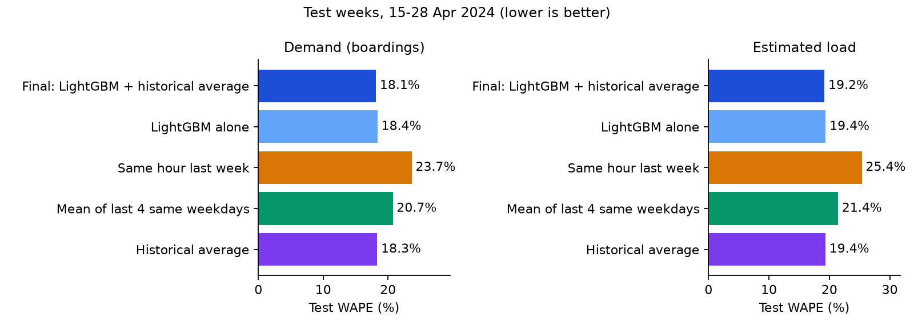
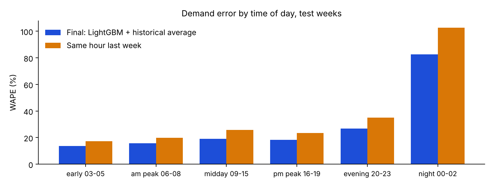
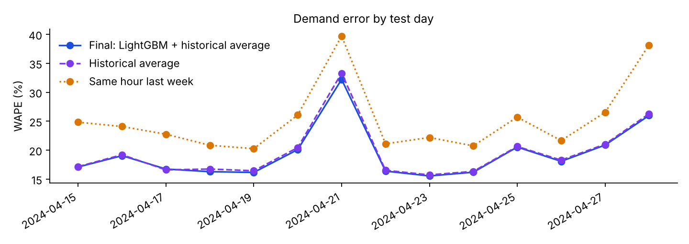
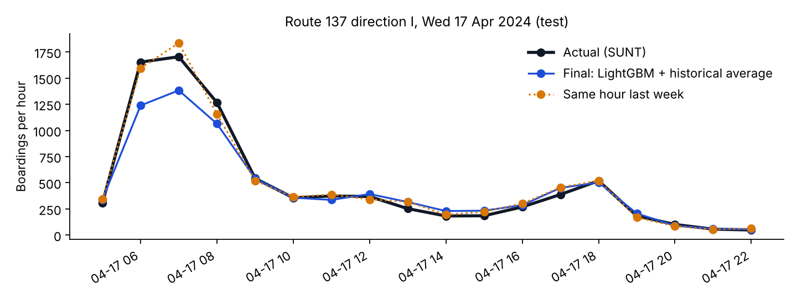
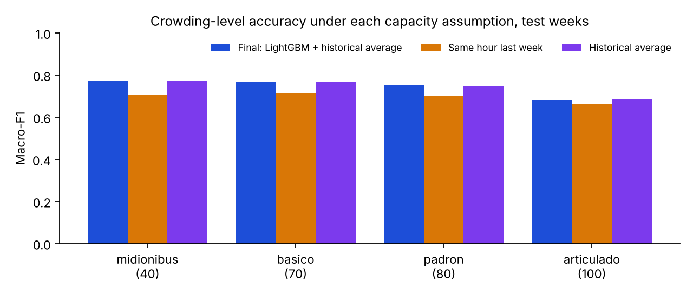

# Results

Generated by `python -m transit.report` from [`metrics.json`](metrics.json) (produced by
`python -m transit.models.run`). Do not edit numbers by hand.

**Protocol.** Train 2024-03-01 to 2024-04-07; tune on validation
2024-04-08 to 2024-04-14; refit on train + validation; score on test
2024-04-15 to 2024-04-28 (scored twice in total; see the disclosure below). Day-ahead: features for day D use only days before D.
Only observed route-hours are scored; missing records are never scored (decision D8).
The occupancy target is **estimated on-board load** from SUNT fare-card trip chaining, not measured occupancy.

**Final forecast.** Final: LightGBM + historical average: 0.5 × LightGBM +
0.5 × historical average, with the weight chosen on validation (decision D12).

**Test-set disclosure.** The test weeks were scored once before the blend existed:

- **v1 (LightGBM alone, 24 Oct 2026)** ([file](../reports/archive/metrics_v1_lightgbm_only.json)): demand test WAPE LightGBM 18.39%, historical average 18.35%; load LightGBM 19.39%, historical average 19.35%. First and only earlier test scoring. It showed LightGBM tying the historical average; the blend was then chosen on validation only.

## Demand: boardings per route-hour (test, 127,935 route-hours)

| Method | MAE | RMSE | WAPE | Bias | WAPE change vs last week |
| --- | --- | --- | --- | --- | --- |
| Final: LightGBM + historical average | 17.86 | 29.72 | 18.15% | -0.49 | -23.3% |
| LightGBM alone | 18.10 | 31.34 | 18.39% | +0.20 | -22.3% |
| Same hour last week | 23.30 | 37.93 | 23.67% | +0.24 | reference |
| Mean of last 4 same weekdays | 20.42 | 33.64 | 20.75% | -3.30 | -12.3% |
| Historical average | 18.06 | 29.58 | 18.35% | -1.19 | -22.5% |

LightGBM chosen on validation: objective `regression_l1`, 63 leaves, 130 rounds. Validation WAPE: final 18.65%,
LightGBM 18.84%, historical average 18.99%,
last week 25.68%. Blend weights tried on validation:
0.0 → 18.99%, 0.25 → 18.76%, 0.5 → 18.65%, 0.75 → 18.68%, 1.0 → 18.84%.

**Is the gain real?** Paired bootstrap over route-directions (2,000 resamples; negative = final forecast better):

| Target | Final minus | WAPE difference (points) | 95% interval | Resamples where final is better |
| --- | --- | --- | --- | --- |
| demand | Historical average | -0.20 | -0.29 to -0.06 | 99.65% |
| demand | Same hour last week | -5.52 | -5.79 to -5.26 | 100.00% |
| demand | LightGBM alone | -0.24 | -0.41 to -0.13 | 100.00% |
| load | Historical average | -0.15 | -0.18 to -0.13 | 100.00% |
| load | Same hour last week | -6.19 | -6.41 to -5.98 | 100.00% |
| load | LightGBM alone | -0.19 | -0.22 to -0.17 | 100.00% |

**Ablation (validation week).**

| Features | MAE | WAPE |
| --- | --- | --- |
| calendar + route only | 21.35 | 21.64% |
| + same-hour history (lags, means) | 18.63 | 18.89% |
| all features | 18.58 | 18.84% |

**Largest gain shares:** `y_hist_daytype` 72.94%, `y_roll7` 11.82%, `y_mean_dow4` 5.19%, `route` 4.07%, `y_lag1` 1.44%.

### Where demand errors are

| Segment | Rows | Final WAPE | Historical avg WAPE | Last-week WAPE |
| --- | --- | --- | --- | --- |
| early 03-05 | 9,318 | 13.80% | 13.99% | 17.34% |
| am peak 06-08 | 21,333 | 15.75% | 15.65% | 19.82% |
| midday 09-15 | 45,682 | 19.15% | 19.37% | 25.90% |
| pm peak 16-19 | 26,964 | 18.25% | 18.65% | 23.50% |
| evening 20-23 | 22,401 | 26.72% | 27.13% | 35.00% |
| night 00-02 | 2,237 | 82.58% | 83.03% | 102.69% |

| Segment | Rows | Final WAPE | Historical avg WAPE | Last-week WAPE |
| --- | --- | --- | --- | --- |
| low | 28,786 | 29.72% | 30.09% | 39.03% |
| middle | 45,782 | 22.92% | 23.31% | 29.78% |
| high | 53,367 | 15.44% | 15.56% | 20.16% |

| Segment | Rows | Final WAPE | Historical avg WAPE | Last-week WAPE |
| --- | --- | --- | --- | --- |
| saturday | 17,317 | 20.48% | 20.74% | 26.30% |
| sunday | 15,814 | 29.05% | 29.72% | 38.91% |
| weekday | 94,804 | 17.18% | 17.34% | 22.39% |

Regular vs non-regular cells (non-regular = observed in an hour the route does not run on most training days):

| Segment | Rows | Final WAPE | Historical avg WAPE | Last-week WAPE |
| --- | --- | --- | --- | --- |
| non-regular cell | 2,254 | 55.83% | 58.26% | 69.16% |
| regular cell | 125,681 | 18.08% | 18.28% | 23.59% |

Worst test day: 2024-04-21 (final WAPE 32.21%). Best: 2024-04-23
(15.54%).

Route-directions with the largest total absolute error (final forecast):

| Route | Dir | Rows | WAPE | Share of all error |
| --- | --- | --- | --- | --- |
| 137 | I | 256 | 14.68% | 0.70% |
| 1386 | V | 277 | 16.75% | 0.67% |
| 138 | I | 266 | 14.45% | 0.59% |
| 1007 | I | 278 | 14.15% | 0.59% |
| 1007 | V | 276 | 16.02% | 0.57% |

Hours with zero recorded boardings (5,165 test rows): final-forecast MAE
2.95, last-week MAE 2.81.

## Estimated load: mean peak load per bus per route-hour (test, 127,855 route-hours)

| Method | MAE | RMSE | WAPE | Bias | WAPE change vs last week |
| --- | --- | --- | --- | --- | --- |
| Final: LightGBM + historical average | 4.69 | 6.90 | 19.20% | -0.34 | -24.4% |
| LightGBM alone | 4.74 | 6.96 | 19.39% | -0.34 | -23.6% |
| Same hour last week | 6.21 | 9.07 | 25.39% | -0.02 | reference |
| Mean of last 4 same weekdays | 5.24 | 7.64 | 21.45% | -0.51 | -15.5% |
| Historical average | 4.73 | 6.96 | 19.35% | -0.34 | -23.8% |

Chosen on validation: objective `regression_l1`, 63 leaves, 140 rounds.

**Ablation (validation week).**

| Features | MAE | WAPE |
| --- | --- | --- |
| calendar + route only | 5.20 | 21.22% |
| + same-hour history (lags, means) | 4.82 | 19.67% |
| all features | 4.78 | 19.54% |

**Largest gain shares:** `y_hist_daytype` 70.93%, `y_roll7` 13.15%, `route` 5.86%, `y_lag1` 2.34%, `y_mean_dow4` 2.19%.

**Burst hours** (a stop with more than 100 boardings; kept, not capped):

| Hours | Rows | Final MAE | Final WAPE | Last-week MAE |
| --- | --- | --- | --- | --- |
| Without burst | 127,409 | 4.67 | 19.24% | 6.19 |
| With burst | 446 | 9.98 | 14.73% | 10.90 |

## Crowding levels and capacity sensitivity (test)

Capacity from ABNT NBR 15570:2009, Table 1 (minimum capacity by vehicle class) and Table 2 (6 standing passengers per m2). Levels: low < 50%,
high ≥ 80% of capacity.

| Scenario (capacity) | Actual low / medium / high | Final macro-F1 | Last-week macro-F1 | Hist. avg macro-F1 | Final high precision | Final high recall |
| --- | --- | --- | --- | --- | --- | --- |
| midionibus (40) | 45.52% / 26.25% / 28.23% | 0.772 | 0.708 | 0.771 | 0.847 | 0.787 |
| basico (70) | 76.64% / 18.17% / 5.19% | 0.769 | 0.713 | 0.766 | 0.786 | 0.610 |
| padron (80) | 83.15% / 14.26% / 2.59% | 0.751 | 0.701 | 0.748 | 0.782 | 0.498 |
| articulado (100) | 91.70% / 7.79% / 0.51% | 0.683 | 0.663 | 0.686 | 0.773 | 0.250 |

Base case (ônibus básico, 70) confusion matrix for the final forecast (rows actual, columns predicted; low, medium, high):

| | pred low | pred medium | pred high |
| --- | --- | --- | --- |
| actual low | 93,779 | 4,168 | 38 |
| actual medium | 6,950 | 15,223 | 1,062 |
| actual high | 282 | 2,307 | 4,046 |

## Check: metrics recomputed from the committed prediction files

| Target | Method | Rows | WAPE | Matches metrics.json |
| --- | --- | --- | --- | --- |
| demand | Final: LightGBM + historical average | 127,935 | 18.15% | yes |
| demand | LightGBM alone | 127,935 | 18.39% | yes |
| demand | Same hour last week | 127,935 | 23.67% | yes |
| demand | Mean of last 4 same weekdays | 127,935 | 20.75% | yes |
| demand | Historical average | 127,935 | 18.35% | yes |
| load | Final: LightGBM + historical average | 127,855 | 19.20% | yes |
| load | LightGBM alone | 127,855 | 19.39% | yes |
| load | Same hour last week | 127,855 | 25.39% | yes |
| load | Mean of last 4 same weekdays | 127,855 | 21.45% | yes |
| load | Historical average | 127,855 | 19.35% | yes |

## Limitations

- Loads are SUNT estimates from trip chaining; riders aged 65+ are not recorded; capacity is assumed.
- One city (Salvador, Brazil), 59 days; no holiday in the test weeks; no Indian or tier-2 validation.
- The forecast is conditional on a route running in that hour (D8); missing records are not scored.
- Validation figures were used for selection and are optimistic; test figures are the honest estimate.
- The test weeks were scored twice (see the disclosure above); the blend weight was chosen on validation only.
- LightGBM on its own does not beat a well-chosen historical average; most predictable structure here is a
  stable weekly profile per route and hour.
