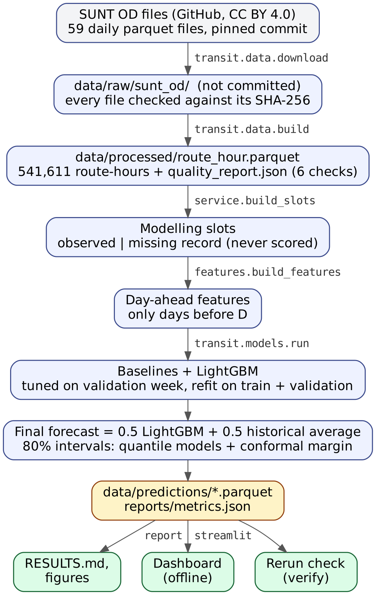

<!--
Editable source of the project report. Build the DOCX and PDF with:
    python reports/project_report/build_report.py
Every number must agree with reports/RESULTS.md (generated by python -m transit.report).
Do not edit numbers here without checking them there first.
-->

<!-- titlepage:start (the build script lays this block out as the title page) -->

**PDPM Indian Institute of Information Technology, Design and Manufacturing, Jabalpur**

**CS3011 Artificial Intelligence: course project report**

## AI Based Public Transport Demand and Occupancy Prediction

**Group 52** · Domain: Machine Learning

| Member | Presents and answers questions on (provisional) |
| --- | --- |
| Jay Pravin Vaghela (group lead) | Framing, architecture, models and the blend decision |
| Akshar Jasoliya | Data, licence, pipeline and quality rules |
| Tirth Jasoliya | Evaluation protocol, results and error analysis |
| Disha Khushalani | Dashboard demo and deployment |
| Shivani Mahour | Crowding, capacity assumption and limitations |

Report date: 24 October 2026

Code and results: <https://github.com/jayvaghela779/cs3011-public-transport-demand-occupancy> (branch `main`)

Data: Salvador Urban Network Transportation (SUNT) dataset, Ferreira et al. (2025), CC BY 4.0

<!-- titlepage:end -->

# Abstract

Bus operators plan frequencies and vehicle sizes from expected demand, but the passenger counts they need are rarely open. This project builds and evaluates a day-ahead forecasting system for public-transport **demand** (boardings per route, direction and hour) and **estimated on-board load** (our occupancy target), with crowding levels derived from the load forecast. We use the open, peer-reviewed SUNT dataset from Salvador, Brazil (CC BY 4.0): 59 days of fare-card and vehicle-location records (37.6 million stop events) aggregated to 541,611 route-hours. Alightings in SUNT are inferred by trip chaining, so load is an estimate, not a measurement.

We compare LightGBM gradient-boosted trees with three baselines on a chronological split (train 1 March–7 April 2024, validation 8–14 April, test 15–28 April). The final forecast, an equal blend of LightGBM and a historical average with the weight chosen on validation, reaches a test weighted absolute percentage error (WAPE) of 18.15% for demand and 19.20% for estimated load. This is about 23% lower than the common "same hour last week" rule (23.67% and 25.39%), but only slightly better than a well-chosen historical average (18.35% and 19.35%; demand difference −0.20 points, 95% paired-bootstrap interval −0.29 to −0.06), and only in absolute error: on RMSE the historical average is slightly better for demand. Crowding levels for a 70-passenger bus reach a macro-F1 of 0.769, and between 0.683 and 0.772 across four capacity assumptions. Calibrated 80% prediction intervals cover 80.4% of test demand and 79.3% of test load, but only about 52% of night-time load values. The test weeks were scored twice, and both scorings are disclosed. Every number is produced by committed code; 86 automated tests and a verification command check that the results reproduce.

**Keywords:** public transport; passenger demand forecasting; estimated on-board load; crowding; smart-card (AFC) data; LightGBM; gradient boosting; conformal prediction; reproducibility.

# How to read this report

The report separates three kinds of statement:

- **Measured:** results of experiments that were actually run. All of them come from `reports/metrics.json`, the committed prediction files and `reports/RESULTS.md`, which `python -m transit.report` generates from them. Where a number in this report was computed separately from the committed prediction files (for illustration only), the text says so.
- **Assumption:** choices the data cannot settle, such as vehicle capacity. Each is labelled and, where possible, varied in a sensitivity analysis.
- **Proposed / future work:** ideas that were *not* implemented or tested.

"Load" and "occupancy" in this report always mean **estimated on-board load** derived from fare-card trip chaining. It is never directly measured occupancy.

# 1. Problem statement, objectives and scope

## 1.1 Problem

Public-transport planners decide, a day or more in advance, how many trips to run on each route in each hour and which vehicles to use. Too little capacity leaves passengers behind on overcrowded buses; too much wastes fuel and crew time. Good decisions need a forecast of how many people will board, and of how full the buses will be.

The registered project description is to analyse public-transport data to predict passenger demand and occupancy, so that service planning can respond to demand. Our working title at registration time mentioned tier-2 Indian cities. The registered title does not, and, as section 2 explains, no open dataset we found for Indian or tier-2 cities contained both demand and occupancy labels. **This project therefore makes no claim of validation for Indian or tier-2 cities.**

## 1.2 Learning problem

Stated in the standard form of a learning problem (task, experience, performance):

- **Task T:** before a service day starts, predict for every route, direction and clock hour (a) the number of boardings and (b) the estimated peak on-board load of a typical bus; derive a crowding level (low, medium, high) from (b).
- **Experience E:** 38 training days of SUNT records from Salvador, plus one validation week for model selection.
- **Performance P:** WAPE, MAE and RMSE on two unseen test weeks for the two regression targets; macro-F1 and a confusion matrix for crowding levels; empirical coverage of 80% prediction intervals.

Both targets are supervised regression problems; crowding is a classification derived from the regression output.

## 1.3 Objectives

1. Build a verified, reproducible data pipeline from the raw SUNT files to a route-hour modelling table, with written rules for every data-quality problem.
2. Forecast day-ahead boardings per route-hour, and compare a machine-learning model honestly with simple baselines on identical rows.
3. Forecast day-ahead estimated on-board load and derive crowding levels under documented, varied capacity assumptions.
4. Quantify uncertainty: confidence intervals for the improvement over baselines, and prediction intervals for individual forecasts.
5. Provide an interactive dashboard that runs offline on a laptop.
6. Make every reported number traceable to committed code and outputs.

## 1.4 Scope

**In scope:** bus routes of Salvador, Brazil, 1 March–28 April 2024; route × direction × hour; day-ahead forecasts; crowding under assumed capacities; a local Streamlit dashboard.

**Out of scope:** stop-level or real-time (within-day) forecasting; cancellations and timetable changes; holiday effects (none in the test weeks); recommending a specific number of extra trips (decision D5 leaves this optional; it was not built); deployment as a production service. The dashboard runs locally and **has not been deployed** at the time of writing.

# 2. Dataset selection, provenance, licensing and limitations

## 2.1 Selection

We needed open data with (i) passenger demand, (ii) some measure of how full vehicles are, (iii) at least several weeks of history, and (iv) a licence allowing reuse. Decision D1 in the repository records the comparison. Candidates included Victoria train counts, UrbanBus, TfNSW bus occupancy, TfL BUSTO, MTA hourly ridership, Trafiklab KoDa, Bengaluru metro (BMRCL) ridership and the repositories the team first collected (SUNT, the PMPML Pune GTFS generator, and an Aarhus University thesis repository). Timetable-only sources such as GTFS contain routes and schedules but no passenger counts, so they cannot provide training labels. The Indian sources we found had demand counts only (Bengaluru metro: hourly entries for about seven weeks) or nothing usable for tier-2 cities. The Ahmedabad–Gandhinagar dataset on Mendeley Data infers crowdedness from the smartphone sensors of a few commuters and has no route-level counts; the team read its description but did not inspect its files.

**SUNT** was the only candidate we could download and open that contained both boardings and an on-board load estimate, under an open licence and with a peer-reviewed description (Ferreira et al., 2025).

## 2.2 Provenance

| Item | Value |
| --- | --- |
| Dataset | Salvador Urban Network Transportation (SUNT), LabIA, Federal University of Bahia |
| Description paper | Ferreira et al., *Scientific Data* 12, 1320 (2025) |
| Dataset DOI | 10.17632/85fdtx3kr5.1 (Mendeley Data, version 1) |
| Files used | Daily origin-destination (OD) tables `data/od/od-YYYY-MM-DD.parquet` from the LabIA-UFBA/SUNT GitHub repository |
| Pinned version | SUNT commit `f8d90fb38f3b1a6f74a18f0298d72fe0c6eaa54c` |
| Period | 1 March–28 April 2024: 59 daily files, about 510 MB |
| Integrity | SHA-256 checksum of every file, in `data/manifest/sunt_od_manifest.csv` |

29 and 30 April 2024 are excluded because those files cover noticeably fewer routes than other weekdays.

Each OD row is one vehicle stop event on a trip (route, direction, trip, stop, timestamp) with the number of boardings, the number of inferred alightings and the estimated load. According to the SUNT description, boardings come from contactless fare-card validations matched to vehicle GPS. Salvador has no exit validators, so **alightings are inferred** by trip chaining: a passenger's alighting stop is taken from their next boarding, within walking distance. Load is boardings minus inferred alightings, accumulated along the trip, and is therefore an estimate.

## 2.3 Licence

The SUNT data is licensed **CC BY 4.0**. The team checked this on 24 October 2026 on all three hosts: the GitHub README, the Mendeley Data record and the Hugging Face dataset card. CC BY 4.0 allows sharing adapted data with attribution, a link to the licence and a statement of changes. Our changes are: selection of 59 daily files at the pinned commit; renaming of columns; aggregation from stop events to route × direction × hour; and removal of stop, vehicle and register identifiers from the output. No values were edited, capped or removed. Raw SUNT files are never committed to our repository; the pipeline downloads them.

The *Scientific Data* article carries its own licence (CC BY-NC-ND 4.0 according to its rights section). We cite it; we do not reproduce its text.

No code was copied from the repositories that have no licence (the SUNT examples repository and the Aarhus thesis repository). They were read for ideas and are cited (decision D6). The licence for our own code is still to be agreed by the team.

## 2.4 Data quality (measured)

The build step (`python -m transit.data.build`) writes `data/processed/quality_report.json`. All six automated checks passed.

| Measure | Value |
| --- | --- |
| Stop events read | 37,600,997 |
| Route-hour rows produced | 541,611 |
| Routes; route-directions | 410; 713 |
| Total boardings | 51,353,180 |
| Burst stop events (more than 100 boardings at one stop) | 2,685 |
| Trips repeating a stop sequence number (malformed) | 222 of 1,168,044 (0.019%), in 116 route-hours |
| Raw stop events with a negative value | 1 |
| Route-hours with no load value | 340 |
| Highest estimated load at one stop event | 469.6 |

The six checks are: unique (route, direction, hour) keys; all 59 days present; boardings conserved exactly between raw and aggregated data (largest relative difference 0); no negative aggregated values; malformed trips under 0.1%; and no stop events outside a 30-hour service window.

**External plausibility check.** Salvador's mobility department reports that the conventional bus system carried about 1.25 million passengers per day in 2024 (Prefeitura de Salvador, 2025). SUNT's mean over the 40 ordinary weekdays in our period is 1,061,538 recorded boardings, about 85% of that figure. The gap is consistent with SUNT's documented exclusions (riders aged 65 and over travel without cards; some validations cannot be matched to a trip). Because the published figure is rounded and its day basis is not stated, this is a sanity check, not a reconciliation.

## 2.5 Data limitations and how each is handled

| Limitation | Effect | Handling (decision) |
| --- | --- | --- |
| Alightings are inferred, not counted | Load is an estimate | Called "estimated on-board load" everywhere (D2) |
| Riders aged 65+ have no card | Demand and load are under-counted | Stated as a limitation |
| No vehicle capacity in the data | Crowding needs an assumption | ABNT NBR 15570 capacities, four scenarios (D10) |
| Burst validations at terminals (99.8% at 10 stops, first stop of a trip, peak hours) | Very large single-stop counts; highest load 469.6 | Kept and flagged, reported separately, not capped (D11) |
| 222 malformed trips on 2–3 April (three route-directions) | Load chain broken | Flagged; their loads are never used as targets (D9) |
| Absent route-hours: "no bus" or "no record"? SUNT's timetable covers 21 May–21 June 2024, not our period | Cannot distinguish missing data from no service | Missing records are never treated as zero (D8, section 3.3) |
| 2 April 2024 looks like a partial outage | About 911,000 boardings against about 1.1 million on other Tuesdays | Affected hours become missing records |
| One city, 59 days, no holiday in the test weeks | Limited generalisation | Stated; no claim beyond Salvador |

# 3. System architecture and data-processing pipeline

## 3.1 Overview

Data flows in one direction (Figure 1). Each stage is a command that reads the previous stage's output and writes files, so any stage can be rerun and compared. The code is a Python package, `transit`, in `src/transit/`.

{width=60%}

| Stage | Command or function | Main output |
| --- | --- | --- |
| Download and verify | `python -m transit.data.download` | 59 raw files, each checked against its SHA-256 |
| Aggregate and check | `python -m transit.data.build` | `route_hour.parquet` (541,611 rows), `quality_report.json` |
| Service profile and slots | `transit.data.service.build_slots` | observed and missing-record slots (in memory) |
| Features | `transit.features.build_features` | day-ahead feature frame per target (in memory) |
| Train, tune, evaluate | `python -m transit.models.run` | `metrics.json`, prediction files, tuning tables |
| Report | `python -m transit.report` | `RESULTS.md`, figures, `planning.json` |
| Verify a rerun | `python -m transit.verify` | pass or a list of differences |
| Dashboard | `streamlit run app/streamlit_app.py` | interactive pages, read-only |

## 3.2 Aggregation to route-hours

`aggregate_day` (in `src/transit/data/aggregate.py`) turns one day of stop events into one row per route, direction and clock hour of the stop time (decision D7). Route-hour is the level at which planners set frequencies, and it keeps the table small (about 12.5 MB). A SUNT service day runs from about 03:45 to about 02:15 the next morning, so the clock hour, not the calendar date, is the time key; events after midnight keep their real clock hour and are later given a `service_hour` of 24–26. Stop events outside a 30-hour window from the service date's midnight would be counted and dropped; there were none.

For each route-hour the table stores boardings, inferred alightings, stop events, distinct trips, the maximum load at any stop event (`load_max`), the occupancy target `load_trip_peak_mean` (defined in section 4.1), the number of burst events and the number of malformed trips.

## 3.3 Missing route-hours (decision D8)

A route-hour has a row only if SUNT recorded a stop event. An absent hour can mean "no bus was scheduled" or "a bus ran but SUNT has no record". Filling absent hours with zero would invent passenger-free hours and make the test set artificially easy. Instead, `build_slots` (in `src/transit/data/service.py`) uses a **service profile computed from training days only**:

1. Each (route, direction, day type, service hour) cell is *regular* if it was observed on at least 80% of training days of that day type (weekday, Saturday, Sunday, holiday).
2. An absent hour in a regular cell is a **missing record**: it is predicted (so the dashboard can show it) but excluded from targets, features and metrics.
3. Absent hours in non-regular cells are treated as no regular service and are not predicted.
4. Observed hours with zero boardings (a bus ran, no card was tapped) are real zeros and are kept as targets.
5. Route-directions observed on fewer than 10 training days are out of scope.

| Kind of slot | Train | Validation | Test |
| --- | --- | --- | --- |
| Observed (scored) | 348,243 | 64,273 | 127,935 |
| Missing record (predicted, never scored) | 3,309 | 1,060 | 2,797 |

The forecast is therefore "boardings in this hour, given that the route runs", which matches how an operator with a timetable would use it.

# 4. Targets, features, models and baselines

## 4.1 Forecasting targets

- **Demand:** `boardings`, the sum of fare-card boardings on a route-direction in a clock hour.
- **Estimated load:** `load_trip_peak_mean`. For each trip with stop events in the hour, take that trip's highest estimated load; then average over the trips. In words: the peak load of a typical bus on that route in that hour. As a formula: load\_trip\_peak\_mean = (1/n) × Σ over trips j of max over stop events k of load(j, k), where n is the number of trips in the hour. It is used as the target only where the load is reliable (no malformed trip, value present).

## 4.2 Forecast setting

Forecasts are **day-ahead**: before service day *D* starts, every slot of day *D* is predicted. Every feature for day *D* uses only service days strictly before *D*. Because day *D*−1 ends around 02:15, before day *D*'s first trips, all of the previous day is available in time.

## 4.3 Features

All features are computed in `src/transit/features.py`. Values from missing records are `NaN`, never zero.

| Group | Features |
| --- | --- |
| Identity (categorical) | route, direction |
| Calendar | service hour, day of week, weekend flag, holiday flag, "7 days ago was a holiday" |
| Same-hour history of the target | values 1, 7, 14, 21 and 28 days earlier (`y_lag1` … `y_lag28`); mean of the last 4 same weekdays (`y_mean_dow4`); mean of the last 7 days (`y_roll7`); mean of all earlier days of the same day type (`y_hist_daytype`) |
| Service intensity | number of trips in that hour 7 days earlier, and the mean over the last 4 same weekdays |
| Route-day totals | the route-direction's total on the previous day and 7 days earlier |
| Load model only | boardings at that hour 7 days earlier, and over the last 4 same weekdays |

**Leakage control.** The test `test_features_for_day_d_ignore_day_d_and_later` multiplies all data from a day *D* onward by 50 and checks that the features of day *D* do not change (while its target does).

## 4.4 Baselines

Three baselines are scored on exactly the same rows as the model:

- **Same hour last week** (seasonal naive): `y_lag7`. This is a common planning rule of thumb.
- **Mean of the last 4 same weekdays:** `y_mean_dow4`.
- **Historical average:** `y_hist_daytype`, the mean of all earlier days of the same day type at that hour. It is a strong statistical baseline.

If the primary value is missing, each baseline falls back to the historical average, then the 7-day mean, then the training median for that hour, so every scored row has a baseline prediction. On the demand test set, "same hour last week" used its primary value for 126,281 of 127,935 rows; the counts for every baseline are in `metrics.json`.

## 4.5 Model: LightGBM

LightGBM (Ke et al., 2017) is a gradient-boosted decision-tree library. We chose it because trees handle mixed numerical and categorical inputs and missing values natively, capture non-linear interactions (for example between route and hour), train in seconds to minutes on a laptop for about 350,000 training rows, and are deterministic with a fixed seed. Route and direction are categorical features, so one model serves all routes. We did not try deep sequence models (LSTM, GRU) or per-route statistical models (SARIMA); with about 660 route-directions and 38 training days, one tree model with shared structure was the simpler and more testable choice. We make no claim about how those alternatives would perform.

Fixed settings: learning rate 0.05, at least 50 rows per leaf, feature and bagging fractions 0.8, L2 regularisation 1.0, seed 42, deterministic mode, 2 threads. Six configurations per target (objectives and tree sizes, Table 4) were each trained on the training period with early stopping on the validation week (up to 3,000 rounds, patience 100). Predictions are clipped at zero.

## 4.6 Final forecast: a validation-chosen blend (decision D12)

The final forecast is

> final forecast = w × LightGBM forecast + (1 − w) × historical average,

with w chosen on the validation week from {0, 0.25, 0.5, 0.75, 1}. Section 5.4 explains why this blend exists. Validation chose w = 0.5 for both targets.

## 4.7 Prediction intervals (decision D13)

Each forecast has an 80% prediction interval. Two quantile LightGBM models (10% and 90% quantiles) are early-stopped on validation and refit on training plus validation. The interval is then widened by a split-conformal margin computed on the validation week, following conformalised quantile regression (Romano et al., 2019): the margin is the appropriate quantile of max(lower − actual, actual − upper) over validation rows, with the finite-sample correction. Point forecasts are unchanged by this step.

# 5. Experimental methodology

## 5.1 Chronological split

| Split | Dates (2024) | Use |
| --- | --- | --- |
| Train | 1 March–7 April (38 days) | Model fitting; service profile |
| Validation | 8–14 April | All choices: configuration, number of rounds, blend weight, interval margin, ablation |
| Test | 15–28 April (14 days) | Final scoring only |

The split is by date, never random: a random split would let the model learn from days after the ones it predicts. Good Friday (29 March) falls in the training period, so holiday behaviour is not tested. The test weeks contain no weekday national holiday (Tiradentes, 21 April 2024, fell on a Sunday).

## 5.2 Protocol

1. Fit each configuration on train with early stopping on validation; choose the lowest validation WAPE.
2. Run a feature-group ablation on validation.
3. Refit the chosen configuration on train + validation for the same number of rounds (no week is left to stop on).
4. Choose the blend weight and the conformal margin on validation predictions.
5. Score all methods on the test weeks, on observed route-hours only.
6. Produce a forecast for 29 April 2024, for which our data has no actuals (a demonstration only).

**Rolling inputs, fixed model.** During the test weeks the model is not retrained. Its *inputs* move forward each day: the features for 17 April use actual values up to 16 April, including earlier test days, as they would in a real day-ahead deployment.

## 5.3 Metrics

For actual values y and forecasts ŷ over n scored route-hours (sums run over those route-hours):

- MAE = Σ|ŷ − y| / n; RMSE = √(Σ(ŷ − y)² / n); Bias = Σ(ŷ − y) / n (positive means over-forecasting).
- WAPE = Σ|ŷ − y| / Σ|y|: total error relative to total passengers. We use WAPE rather than MAPE because 5,165 observed test hours have zero boardings, for which a percentage error is undefined.
- **Crowding:** macro-F1 (the unweighted mean of the per-class F1 scores), per-class precision and recall, and the confusion matrix.
- **Intervals:** coverage (share of actual values inside the interval) and mean width.
- **Is a gain real?** A paired cluster bootstrap (Efron and Tibshirani, 1993) over route-directions: route-directions are resampled with replacement 2,000 times, because hours of the same route are correlated, and the 2.5% and 97.5% quantiles of the WAPE difference give a 95% interval.

## 5.4 Test-set disclosure: the test weeks were scored twice

1. **First scoring (v1, LightGBM alone).** The first full run scored LightGBM alone. It beat "same hour last week" clearly but tied the historical average (demand test WAPE 18.39% against 18.35%; load 19.39% against 19.35%). The validation week had shown the same pattern. These results are kept in `reports/archive/metrics_v1_lightgbm_only.json`.
2. **Diagnosis on validation only** (`reports/archive/experiments_validation_v2.csv`). A history-length feature made demand worse (19.14% to 19.16% validation WAPE, against 18.84% for LightGBM alone). For demand, a model of the residual from the historical average was slightly better than LightGBM alone (18.69% to 18.82%), but it stopped after 11–31 boosting rounds, a sign that little signal remains beyond the weekly profile, and the simpler blend did better still (18.65%).
3. **Second scoring (v2, the blend).** The blend weight was chosen on validation only and the blend was then scored once on test. These are the results reported in section 6.

The blend was motivated by what the first test scoring showed, so the test weeks are not perfectly untouched. We report both scorings. No further changes were tested on the test weeks, and none were made for this report.

# 6. Results

All results in this section are **measured** on the test weeks (15–28 April 2024) unless marked otherwise. They come from `reports/RESULTS.md`.

## 6.1 Main results

**Table 1. Demand: boardings per route-hour (test, 127,935 route-hours).**

| Method | MAE | RMSE | WAPE | Bias | WAPE change vs last week |
| --- | --- | --- | --- | --- | --- |
| **Final: 0.5 × LightGBM + 0.5 × historical average** | **17.86** | 29.72 | **18.15%** | −0.49 | −23.3% |
| LightGBM alone | 18.10 | 31.34 | 18.39% | +0.20 | −22.3% |
| Historical average | 18.06 | 29.58 | 18.35% | −1.19 | −22.5% |
| Mean of last 4 same weekdays | 20.42 | 33.64 | 20.75% | −3.30 | −12.3% |
| Same hour last week | 23.30 | 37.93 | 23.67% | +0.24 | reference |

**Table 2. Estimated load: mean peak load per bus per route-hour (test, 127,855 route-hours).**

| Method | MAE | RMSE | WAPE | Bias | WAPE change vs last week |
| --- | --- | --- | --- | --- | --- |
| **Final: 0.5 × LightGBM + 0.5 × historical average** | **4.69** | **6.90** | **19.20%** | −0.34 | −24.4% |
| LightGBM alone | 4.74 | 6.96 | 19.39% | −0.34 | −23.6% |
| Historical average | 4.73 | 6.96 | 19.35% | −0.34 | −23.8% |
| Mean of last 4 same weekdays | 5.24 | 7.64 | 21.45% | −0.51 | −15.5% |
| Same hour last week | 6.21 | 9.07 | 25.39% | −0.02 | reference |

The estimated-load test set has 80 fewer rows than the demand test set because route-hours without a reliable load value are not load targets.

{width=100%}

## 6.2 Model selection and ablation (validation week)

**Table 3. Validation-week WAPE of the candidate final forecasts.**

| Target | Final (blend) | LightGBM alone | Historical average | Same hour last week |
| --- | --- | --- | --- | --- |
| Demand | 18.65% | 18.84% | 18.99% | 25.68% |

Blend weights tried on validation (demand): 0.0 → 18.99%, 0.25 → 18.76%, 0.5 → 18.65%, 0.75 → 18.68%, 1.0 → 18.84%.

**Table 4. LightGBM configurations tried (validation WAPE; from `reports/tuning_demand.csv` and `reports/tuning_load.csv`).** The chosen configuration is in bold.

| Objective, leaves | Demand: rounds, WAPE | Objective, leaves | Load: rounds, WAPE |
| --- | --- | --- | --- |
| L2, 63 | 110, 18.98% | L2, 63 | 98, 19.70% |
| **L1, 63** | **130, 18.84%** | **L1, 63** | **140, 19.54%** |
| Poisson, 63 | 188, 18.99% | Huber (α 15), 63 | 131, 19.64% |
| Tweedie (1.3), 63 | 89, 18.91% | Poisson, 63 | 186, 19.70% |
| Poisson, 255 | 178, 19.07% | L1, 255 | 95, 19.58% |
| L2, 255 | 93, 19.05% | L2, 255 | 87, 19.78% |

**Table 5. Feature-group ablation (validation week, chosen configuration).**

| Features | Demand MAE | Demand WAPE | Load MAE | Load WAPE |
| --- | --- | --- | --- | --- |
| Calendar + route only | 21.35 | 21.64% | 5.20 | 21.22% |
| + same-hour history (lags, means) | 18.63 | 18.89% | 4.82 | 19.67% |
| All features | 18.58 | 18.84% | 4.78 | 19.54% |

The largest shares of the final demand model's total split gain are `y_hist_daytype` (72.94%), `y_roll7` (11.82%), `y_mean_dow4` (5.19%), route (4.07%) and `y_lag1` (1.44%). For load: `y_hist_daytype` 70.93%, `y_roll7` 13.15%, route 5.86%, `y_lag1` 2.34%, `y_mean_dow4` 2.19%.

## 6.3 Is the improvement real?

**Table 6. Paired bootstrap over route-directions (2,000 resamples). Negative values mean the final forecast is better.**

| Target | Final minus | WAPE difference (points) | 95% interval | Resamples where final is better |
| --- | --- | --- | --- | --- |
| Demand | Historical average | −0.20 | −0.29 to −0.06 | 99.65% |
| Demand | Same hour last week | −5.52 | −5.79 to −5.26 | 100.00% |
| Demand | LightGBM alone | −0.24 | −0.41 to −0.13 | 100.00% |
| Load | Historical average | −0.15 | −0.18 to −0.13 | 100.00% |
| Load | Same hour last week | −6.19 | −6.41 to −5.98 | 100.00% |
| Load | LightGBM alone | −0.19 | −0.22 to −0.17 | 100.00% |

**Interpretation.** Against the usual planning rule, "same hour last week", the final forecast is much better: about 23% lower WAPE for demand and 24% for estimated load, with intervals far from zero. Against the historical average the gain is **small**: 0.20 WAPE points for demand. The interval excludes zero, and the final forecast has the lower WAPE on 13 of the 14 test days for demand (12 of 14 for estimated load), so the gain is consistent; but it is too small to matter much in practice. It is also a gain in absolute error only: the model was tuned on absolute error, and on RMSE, which weights large errors more, the historical average is slightly better for demand (29.58 against 29.72; for load the final forecast is better, 6.90 against 6.96).

The ablation and the feature importances explain why. Almost all of the model's skill comes from same-hour history, and a single feature, the historical average itself, carries more than 70% of the gain. Bus demand in Salvador in these weeks is dominated by a stable weekly profile per route and hour; once that profile is known, there is little left for a model to learn from the features we have. LightGBM alone did not beat the historical average on test. We report this as a finding rather than hiding it: a well-chosen simple baseline is hard to beat for hourly route demand, and claims of large ML gains should always be checked against one. Note also that the bootstrap resamples route-directions within the same 14 test days: its interval does not cover week-to-week or seasonal variation, nor the extra uncertainty from the test weeks having been scored twice.

## 6.4 Error analysis

**Table 7. Demand WAPE by segment (test).**

| Segment | Rows | Final | Historical average | Same hour last week |
| --- | --- | --- | --- | --- |
| Early 03–05 | 9,318 | 13.80% | 13.99% | 17.34% |
| AM peak 06–08 | 21,333 | 15.75% | 15.65% | 19.82% |
| Midday 09–15 | 45,682 | 19.15% | 19.37% | 25.90% |
| PM peak 16–19 | 26,964 | 18.25% | 18.65% | 23.50% |
| Evening 20–23 | 22,401 | 26.72% | 27.13% | 35.00% |
| Night 00–02 | 2,237 | 82.58% | 83.03% | 102.69% |
| Weekday | 94,804 | 17.18% | 17.34% | 22.39% |
| Saturday | 17,317 | 20.48% | 20.74% | 26.30% |
| Sunday | 15,814 | 29.05% | 29.72% | 38.91% |
| Low-volume routes (lowest third) | 28,786 | 29.72% | 30.09% | 39.03% |
| Middle-volume routes | 45,782 | 22.92% | 23.31% | 29.78% |
| High-volume routes (highest third) | 53,367 | 15.44% | 15.56% | 20.16% |
| Regular cell | 125,681 | 18.08% | 18.28% | 23.59% |
| Non-regular cell | 2,254 | 55.83% | 58.26% | 69.16% |

{width=90%}

{width=90%}

Errors are largest where volumes are low or service is irregular: night hours, Sundays, low-volume routes, and hours outside a route's regular service (non-regular cells). With few passengers, a small absolute error is a large relative one. Every method, including the baselines, struggles in the same places, which points to the data rather than to one model. The final forecast is better than the historical average in every segment except the morning peak (15.75% against 15.65%).

The worst test day was Sunday 21 April 2024 (final WAPE 32.21%), which was also the Tiradentes national holiday; the best was Tuesday 23 April (15.54%). The five route-directions with the largest total absolute error have moderate WAPE (14–17%). They rank first because they carry the most passengers (all five are among the ten busiest of 664 route-directions in the test weeks, computed from the committed prediction file), and each contributes under 1% of all error. No single route dominates the error.

On the 5,165 test hours with zero recorded boardings, the final forecast's MAE is 2.95 boardings, slightly worse than the last-week rule (2.81), which reproduces zeros exactly when the previous week was also zero.

**Burst hours (estimated load).** Route-hours containing a burst validation (446 rows) have a higher final MAE (9.98 against 4.67 without bursts) but a lower WAPE (14.73% against 19.24%), because they are busy hours.

{width=95%}

Figure 5 shows one day of the busiest route-direction in the test weeks. Both forecasts follow the daily shape closely outside the morning peak. In the 06:00–08:00 peak the final forecast stays well below the actual values, while the last-week rule happens to be closer on this day. The example is chosen by a fixed rule in the report generator (the busiest route-direction, on the first test Wednesday), not picked to flatter the model, and it happens to be unfavourable: 17 April is the only test day on which the final forecast's demand WAPE was higher than the historical average's (16.74% against 16.59%). A single day cannot show which method is better overall; Tables 1 and 6 do that. The figure shows the typical shape and that the blend is conservative at the highest peaks.

# 7. Crowding classification and bus-capacity sensitivity

## 7.1 Method (assumption)

SUNT has no vehicle capacity, and the fleet mix per route is unknown. We therefore take the minimum seated-plus-standing capacities set by the Brazilian urban-bus standard ABNT NBR 15570:2009 (Table 1, minimum capacity by vehicle class, with 6 standing passengers per m² from Table 2): midiônibus 40, ônibus básico 70 (the base case), padron 80 and articulado 100 (decision D10). With load factor LF = estimated load ÷ capacity:

- **low:** LF < 0.5; **medium:** 0.5 ≤ LF < 0.8; **high:** LF ≥ 0.8.

The same rule labels both the actual estimated load and the forecast. "Actual" crowding is therefore itself derived from an estimate.

## 7.2 Results (measured)

**Table 8. Crowding levels on the test weeks under each capacity assumption.**

| Scenario (capacity) | Actual low / medium / high | Final macro-F1 | Last-week macro-F1 | Hist. avg macro-F1 | Final "high" precision | Final "high" recall |
| --- | --- | --- | --- | --- | --- | --- |
| Midiônibus (40) | 45.52% / 26.25% / 28.23% | 0.772 | 0.708 | 0.771 | 0.847 | 0.787 |
| Ônibus básico (70) | 76.64% / 18.17% / 5.19% | 0.769 | 0.713 | 0.766 | 0.786 | 0.610 |
| Padron (80) | 83.15% / 14.26% / 2.59% | 0.751 | 0.701 | 0.748 | 0.782 | 0.498 |
| Articulado (100) | 91.70% / 7.79% / 0.51% | 0.683 | 0.663 | 0.686 | 0.773 | 0.250 |

**Table 9. Confusion matrix of the final forecast, base case (capacity 70). Rows are actual levels, columns predicted.**

| | Predicted low | Predicted medium | Predicted high |
| --- | --- | --- | --- |
| Actual low | 93,779 | 4,168 | 38 |
| Actual medium | 6,950 | 15,223 | 1,062 |
| Actual high | 282 | 2,307 | 4,046 |

{width=90%}

**Why macro-F1.** The classes are imbalanced: in the base case 76.64% of test route-hours are actually low. For illustration, computed separately from the committed prediction files for this report: a rule that always predicts "low" would be 76.6% accurate but have a macro-F1 of only 0.289. Macro-F1 weights the rare medium and high classes equally with the common low class.

**Interpretation.** In the base case, when the system flags an hour as high crowding it is right 79% of the time, and it catches 61% of the high hours. Almost all errors are between neighbouring levels (Table 9); "high" is mistaken for "low" in only 282 hours. As the assumed bus gets larger, high crowding becomes rare (0.51% of hours at capacity 100) and recall drops to 0.250 while precision stays between 0.77 and 0.85. Our interpretation is that the forecast, being half a historical average, smooths towards typical values and rarely reaches the extreme peaks. The final forecast beats the last-week rule in every scenario but is level with the historical average (within 0.003 macro-F1). **The crowding results depend strongly on the capacity assumption**, which is why all four scenarios are reported and the dashboard lets the user change it.

## 7.3 Planning use: a daily crowding alert list (measured)

A planner cannot inspect thousands of route-hours a day. We therefore evaluated a simple use: each test day, list the *K* route-hours with the highest forecast estimated load, and measure the share that really were high crowding (at capacity 70), averaged over the 14 test days. The median test day had 580 actually high route-hours.

**Table 10. Precision of the daily top-K alert list (test).**

| K per day | Final forecast | Historical average | Same hour last week |
| --- | --- | --- | --- |
| 25 | 96.00% | 94.00% | 83.71% |
| 50 | 92.14% | 91.43% | 78.57% |
| 100 | 87.07% | 87.50% | 74.36% |

For a daily list of 50 hours, 92.1% of the flagged hours were genuinely high crowding, against 78.6% with the last-week rule. The final forecast and the historical average are again close: their precision differs by at most 2.0 percentage points at K = 25, 50 or 100. The clear gain is over the last-week rule.

# 8. Prediction intervals and uncertainty

## 8.1 Overall coverage (measured)

**Table 11. 80% prediction intervals on the test weeks.**

| Target | Raw coverage | Calibrated coverage | Mean width (calibrated) | Conformal margin |
| --- | --- | --- | --- | --- |
| Demand | 78.93% | 80.39% | 59.6 boardings | 0.00 |
| Estimated load | 79.30% | 79.30% | 15.2 passengers | 0.00 |

On validation the raw quantile models already covered 79.21% (demand) and 80.38% (load), so the conformal margin is almost zero. For demand, even that tiny margin moves about 1.5% of test hours inside the interval; almost all are hours with zero boardings whose raw lower bound was just above zero. The intervals are wide for busy route-hours (about 60 boardings on average), which is the honest uncertainty of an hourly route forecast.

An 80% interval is a long-run coverage rate over many route-hours. It is not a guarantee for any particular route or hour. Validation was used both for early stopping of the quantile models and for the margin, so the calibration is not perfectly independent; the test coverage is the honest check.

## 8.2 Coverage by period: the night-time limitation

**Table 12. Calibrated coverage by period of day and day type.**

| Target | All | Early 03–05 | AM peak 06–08 | Midday 09–15 | PM peak 16–19 | Evening 20–23 | Night 00–02 | Weekday | Weekend |
| --- | --- | --- | --- | --- | --- | --- | --- | --- | --- |
| Demand (test) | 80.39% | 79.21% | 79.44% | 81.36% | 80.64% | 79.13% | 84.26% | 80.82% | 79.18% |
| Load (test) | 79.30% | 79.14% | 79.79% | 80.30% | 80.51% | 78.02% | **52.11%** | 79.75% | 78.02% |
| Demand (validation) | 80.32% | 81.23% | 82.65% | 80.36% | 79.52% | 78.39% | 82.77% | 80.20% | 80.69% |
| Load (validation) | 80.38% | 81.44% | 83.06% | 81.89% | 79.99% | 77.66% | **49.86%** | 80.21% | 80.85% |

Demand coverage stays between 79% and 85% in every period. **Estimated-load intervals cover only 52.11% of night hours (00:00–02:00; 2,157 test rows)**, far below 80%. In those hours 39.96% of actual values fall *below* the interval and 7.93% above it; the intervals are narrow (mean width 4.6 passengers). The validation week shows the same gap (49.86%), so it is a property of the method, not of the test weeks.

The gap was noticed only after the test scoring. A plausible fix is to calibrate a separate conformal margin for each period of the day on the validation week. Applying it now would be a third look at the test weeks, so it has **not** been done; it is reported as a limitation and left as a team decision (D13). Night hours are a small share of all route-hours, but a planner should not trust the night-time load ranges as 80% ranges.

## 8.3 Other sources of uncertainty

- **Label uncertainty:** load is inferred by trip chaining, so even the "actual" values are estimates.
- **Assumption uncertainty:** capacity is assumed; results are given under four capacities rather than one.
- **Sampling uncertainty of the improvement:** handled by the cluster bootstrap (section 6.3).
- **Protocol uncertainty:** the test weeks were scored twice (section 5.4).

# 9. Implementation, reproducibility, testing and dashboard

## 9.1 Implementation

The system is written in Python as an installable package (`transit`), using pandas and PyArrow for data, LightGBM and scikit-learn for modelling and metrics, Matplotlib for report figures, and Streamlit and Plotly for the dashboard. It requires Python 3.10 or newer. Main modules: `config.py` (paths, pinned source, split dates), `data/` (manifest, download, aggregation, build, service profile), `features.py`, `models/` (baselines, LightGBM, the experiment runner), `metrics.py`, `crowding.py`, `report.py`, `verify.py`, and `app/streamlit_app.py`.

The full pipeline is six commands:

```text
python -m transit.data.download   # 59 files, SHA-256 verified
python -m transit.data.build      # route-hour table, 6 quality checks
python -m transit.models.run      # tune, evaluate, forecast (about 8 min)
python -m transit.report          # RESULTS.md and figures
python -m transit.verify          # compare with the committed results
pytest                            # 93 tests
```

## 9.2 Reproducibility (measured)

- **Pinned inputs:** the SUNT download URL contains the exact commit, and every file is checked against its SHA-256.
- **Deterministic training:** LightGBM runs with a fixed seed and its deterministic mode.
- **Generated write-up:** `RESULTS.md` is generated from `metrics.json`; the generator recomputes every test WAPE from the prediction files and stops if any disagrees.
- **Verification command:** `python -m transit.verify` compares a rebuilt route-hour table with the committed one cell by cell, and all 2,326 numbers in `metrics.json` with the committed file (relative tolerance 10⁻⁶; run times ignored). It needs a git clone (not a ZIP download), because it compares against the files committed in git.
- **Fresh-clone rerun (24 October 2026):** on Linux with Python 3.12.3, pandas 3.1.0 and LightGBM 4.7.0, a full rerun from a fresh clone downloaded all 59 files with matching checksums, rebuilt an identical table (541,611 × 12), reproduced all 2,326 values in `metrics.json` and all five prediction files exactly, and regenerated a byte-identical `RESULTS.md`. The whole sequence took about 11 minutes. The committed results were originally produced with Python 3.13 and pandas 3.0.5. The full pipeline has not yet been rerun on Windows or Google Colab; only the tests have.

## 9.3 Testing (measured)

There are 93 automated tests (pytest). GitHub Actions runs them, followed by `python -m transit.verify`, on Ubuntu (Python 3.11 and 3.12) and on Windows (Python 3.12, with both the normal and the locked requirement files). The tests use small hand-written fixtures in the SUNT file format, not observations, except where they check the committed outputs.

| Area | Test file | Tests | What they check |
| --- | --- | --- | --- |
| Configuration | `test_config.py` | 3 | 59-day period, chronological split, pinned commit |
| Aggregation | `test_aggregate.py` | 10 | sums, conservation, service window, after-midnight hours, bursts, malformed trips, failing checks |
| Inputs and time | `test_inputs_and_time.py` | 9 | SUNT data types, missing loads stay NaN, unparseable times, hour boundaries |
| Pipeline end to end | `test_pipeline_e2e.py` | 6 | two-day build, manifest, download verification and checksum rejection |
| Committed table | `test_processed.py` | 14 | the committed table matches its quality report and pinned totals |
| Missing hours | `test_service.py` | 8 | regular cells from training only, missing records not zero, scope rules |
| Features and baselines | `test_features_and_baselines.py` | 8 | **no leakage**, exact lags, fallbacks, metric values, crowding levels |
| Model run | `test_models_run.py` | 6 | complete results, documented blend, weight chosen on validation, beats last week on a learnable pattern |
| Dashboard and outputs | `test_app.py` | 15 | every page renders; reported metrics, coverage and alert precision match the prediction files; missing records never scored |
| Verification | `test_verify.py` | 7 | the comparison logic of `transit.verify`, and a clear message when git is missing |
| Public web build | `test_web.py` | 7 | the web page lists every module and data file the app reads; the site build copies them byte for byte with a SHA-256 manifest; versions are pinned; the app does not load scikit-learn |

On 24 October 2026 the suite passed (93 passed) and `python -m transit.verify` matched all 2,326 values.

## 9.4 Dashboard

The Streamlit dashboard (`app/streamlit_app.py`) reads only committed files, so it starts without downloading SUNT and works offline. It has five pages:

1. **Forecast explorer:** choose the period, route-direction and day; see actual boardings, the final forecast, the last-week rule and the 80% band; the estimated load with the medium and high thresholds for a chosen capacity; and an hour-by-hour crowding strip. Hours with no SUNT record are shown as open circles and are not scored.
2. **Model comparison:** the test tables, a live recomputation of the metrics from the prediction files, error breakdowns, tuning results, the ablation and feature importances.
3. **Crowding and capacity:** results under all four capacities and the confusion matrices.
4. **Next-day forecast:** the forecast for 29 April 2024, with the route-hours forecast as high crowding; labelled as a demonstration because no actuals exist.
5. **Data and limitations:** source, licence, split and every caveat in this report.

{width=100%}

Changing the capacity on the explorer page does not re-run any model; it only moves the threshold lines and relabels the crowding strip. Every page is checked by an automated test that fails on any exception.

## 9.5 Public deployment (GitHub Pages)

The same dashboard is public at **https://jayvaghela779.github.io/cs3011-public-transport-demand-occupancy/**. It is a static GitHub Pages site. The page (`web/index.html`) runs the unchanged `app/streamlit_app.py` inside the visitor's browser with stlite 1.12.0 (Streamlit 1.65 on Pyodide 314.0.3, that is, Python compiled to WebAssembly). This approach was chosen because:

- there is no server that can sleep or fail;
- no account is needed beyond the repository's own GitHub account;
- the site updates itself from `main`.

**How it is published.** A GitHub Actions workflow (`.github/workflows/pages.yml`) runs `web/build_site.py` whenever the app, its modules or the committed results change on `main`.

- It copies the app code and result files to the `gh-pages` branch together with a SHA-256 manifest.
- It also copies three pinned, hash-checked Python wheels (`web/wheels.txt`).

**How it loads.** The page downloads every file through jsDelivr's mirror of that branch and checks each one against the manifest. It re-fetches any stale or failed copy from GitHub Pages itself. So the public site shows exactly the committed results, and no metric or prediction file is changed for it.

**Checked on 24 October 2026 (measured).**

- The published files are byte-identical to `main` (11 app and data files).
- In a real browser on an Indian home connection, all five pages worked and showed the same values as the local app:
  - route 137 I on 17 April: day WAPE 15.3% against 7.7%;
  - next day: 9,566 route-hours, 481 of them high crowding;
  - the in-browser recomputation matched all ten reported test WAPEs;
  - no Python errors.

**Load time (measured).** A first visit downloads about 85 MB: 27 MB of results and about 55 MB of Python runtime and packages.

- A cold load took 83 s on a connection throttled to 10 Mbit/s, and 340 s (about 5 minutes 40 seconds) at 2 Mbit/s, the speed measured on the home network above.
- Repeat visits use the browser cache and were ready in about 40 s.
- On the tested home network, `raw.githubusercontent.com` and `files.pythonhosted.org` were throttled to almost nothing, and `github.io` was slow for large files. That is why the page downloads through jsDelivr and serves the three wheels itself.
- Once, a runtime download stalled inside Pyodide's loader; the page now suggests a reload after two minutes without progress.

For the evaluation the local app remains the primary demo: it starts instantly and needs no internet.

# 10. Limitations

1. **Estimated, not measured, occupancy.** Alightings are inferred by trip chaining; the load target is an estimate (section 2.2).
2. **Under-counting.** Riders aged 65 and over are not recorded; recorded weekday boardings are about 85% of the city's published figure.
3. **Assumed capacity.** Crowding levels depend on an assumed vehicle capacity; results change markedly between scenarios (Table 8).
4. **One city and 59 days.** All data is from Salvador, Brazil, March–April 2024. Nothing here is validated for Indian or tier-2 cities, or for other seasons.
5. **No holiday in the test weeks.** Holiday behaviour is not tested.
6. **Conditional forecast.** Forecasts assume the route runs in that hour; missing records are not scored, and cancellations are not predicted.
7. **Small gain over a strong baseline.** The model's advantage over the historical average is 0.20 WAPE points for demand, in absolute error only (on RMSE the historical average is slightly better for demand). The bootstrap interval covers variation across routes within the 14 test days, not across weeks or seasons.
8. **Test weeks scored twice.** Disclosed in section 5.4.
9. **Night-time load intervals.** About 52% coverage instead of 80% (section 8.2).
10. **Validation optimism.** Validation figures were used for selection and are optimistic; the test figures are the honest estimate.
11. **Heavy public dashboard; limited cross-platform reruns.** The public dashboard downloads about 85 MB on a first visit and needs a recent browser. It runs Streamlit 1.65 on Pyodide rather than the local Streamlit 1.66, so small visual differences are possible. The full pipeline has been rerun on Linux but not yet on Windows or Colab.

# 11. Ethical considerations

- **Privacy.** SUNT is built from fare-card and vehicle-location records. We use only the published OD tables, aggregate them to route-hours, and drop stop, vehicle and register identifiers from our outputs. Nothing in this project attempts to identify or track individual travellers.
- **Fairness and representation.** Riders aged 65 and over, who travel free without a card, are invisible in the data. Planning purely from these forecasts could under-provide service on routes and at times used mainly by older passengers. Any operational use should correct for known gaps with other counts.
- **Honest labelling.** Calling an inferred quantity "occupancy" without qualification could mislead decision-makers. We use "estimated on-board load" throughout, in the code, the dashboard and this report.
- **Automation bias.** The dashboard presents forecasts and crowding colours with an air of precision. Prediction intervals, the capacity selector and the caveats page are there so that users see uncertainty and assumptions, not just a single number. Night-time load ranges should not be trusted as 80% ranges.
- **Transferability.** A model trained on Salvador should not be applied to other cities, including Indian cities, without retraining and validation on local data.
- **Licensing and credit.** The data is used under CC BY 4.0 with attribution and a statement of changes. Repositories without a licence were read for ideas only and are cited, not copied.
- **Use of AI assistance.** The code and documents in the repository, including this report, were written in AI-assisted sessions with Claude (Anthropic), directed and reviewed by the group lead. Every such commit carries a `Co-Authored-By` line; as of 24 October 2026 that is every commit. The team remains responsible for the content and must be able to explain it.

# 12. Future work (proposed; none of this has been done)

- **Per-period interval calibration:** a separate conformal margin for each period of the day, set on validation, to address the night-time gap (D13). Any new evaluation should use new held-out weeks.
- **Fresh held-out data:** re-evaluate on later SUNT weeks (for example May 2024, if available at the pinned source) so that the final method is tested on weeks never seen before.
- **Better inputs:** weather, events and holidays; timetable data for the study period, which would separate "no service" from "no record".
- **Real capacity and counts:** vehicle assignments per trip, or automatic passenger counters, to replace the assumed capacity and to validate the estimated load.
- **Other cities:** test the pipeline on another open dataset with real counts, ideally from an Indian city, before making any claim beyond Salvador.
- **Planning outputs:** an "extra trips needed" estimate under a stated capacity assumption (D5), shown as illustrative only.
- **Lighter public hosting:** a server-side host (for example Streamlit Community Cloud, which needs its own account sign-in) would cut the first-visit download for viewers on slow networks.

# 13. Conclusion

We built an end-to-end, reproducible system that forecasts day-ahead hourly boardings and estimated on-board load for every bus route-direction in Salvador, derives crowding levels under documented capacity assumptions, and presents the results in a dashboard that runs offline on a laptop and publicly in any recent browser. On two held-out weeks, the final forecast (an equal blend of LightGBM and a historical average) has a WAPE of 18.15% for demand and 19.20% for estimated load: about 23–24% better than the "same hour last week" rule, but only marginally better than a well-chosen historical average, and only in absolute error. Crowding levels for a standard bus reach a macro-F1 of 0.769, and a daily list of the 50 most crowded forecast hours is right 92.1% of the time.

The most useful lesson is methodological. A strong, simple baseline captured almost all of the predictable structure, and only careful baselines, a validation-only selection protocol and a cluster bootstrap made that visible. We report the small gain, the second scoring of the test weeks, the dependence on an assumed capacity and the night-time interval gap as they are. Every number in this report can be traced to committed code, checked by automated tests and reproduced from a fresh clone.

# References

1. Ferreira, M. V., Souza, M., Rios, T. N., Fernandes, I. F. C., Nery, J., Gama, J., Bifet, A. and Rios, R. A. (2025). Salvador Urban Network Transportation (SUNT): A Landmark Spatiotemporal Dataset for Public Transportation. *Scientific Data*, 12, 1320. <https://doi.org/10.1038/s41597-025-05674-6>
2. SUNT dataset, Mendeley Data, version 1. <https://doi.org/10.17632/85fdtx3kr5.1> (CC BY 4.0).
3. LabIA-UFBA. SUNT repository, commit `f8d90fb38f3b1a6f74a18f0298d72fe0c6eaa54c`. <https://github.com/LabIA-UFBA/SUNT>
4. Associação Brasileira de Normas Técnicas (2009). *ABNT NBR 15570:2009, Transporte: especificações técnicas para fabricação de veículos de características urbanas para transporte coletivo de passageiros.* Rio de Janeiro: ABNT.
5. Prefeitura de Salvador (2025). *PEPI: Plano de Envolvimento das Partes Interessadas.* <https://mobilidade.salvador.ba.gov.br/wp-content/uploads/2025/10/PEPI-Plano-de-Envolvimento-das-Partes-Interessadas-Def_compressed.pdf>
6. Ke, G., Meng, Q., Finley, T., Wang, T., Chen, W., Ma, W., Ye, Q. and Liu, T.-Y. (2017). LightGBM: A Highly Efficient Gradient Boosting Decision Tree. *Advances in Neural Information Processing Systems 30 (NeurIPS 2017)*.
7. Romano, Y., Patterson, E. and Candès, E. J. (2019). Conformalized Quantile Regression. *Advances in Neural Information Processing Systems 32 (NeurIPS 2019)*. arXiv:1905.03222.
8. Pedregosa, F. et al. (2011). Scikit-learn: Machine Learning in Python. *Journal of Machine Learning Research*, 12, 2825–2830.
9. Efron, B. and Tibshirani, R. J. (1993). *An Introduction to the Bootstrap.* New York: Chapman & Hall.
10. sunt_examples: forecasting examples for the SUNT dataset (GitHub repository `ricardoarios/sunt_examples`). <https://github.com/ricardoarios/sunt_examples> (read for ideas; no code copied).
11. Machine-Learning-Passenger-Forecasting (Aarhus University bachelor's thesis code on bus passenger forecasting). <https://github.com/andr830g/Machine-Learning-Passenger-Forecasting> (read for ideas; no code copied).

# Appendix A. Team and contributions

The table on the title page is the provisional speaking split for the presentation and viva, as recorded in `README.md` and `docs/TEAM_PRESENTATION_GUIDE.md`. It is not a record of who wrote which code.

As recorded in the repository, the code and documents were written in AI-assisted sessions with Claude (Anthropic), directed and reviewed by the group lead, and every commit up to 24 October 2026 carries a `Co-Authored-By` line. Teammates' own reviews, runs and edits are to be committed from their own accounts, so that the Git history shows each contribution. This report does not claim individual contributions beyond what the repository records.

# Appendix B. Decision log index

| ID | Decision |
| --- | --- |
| D1 | SUNT OD tables, 1 March–28 April 2024, as the primary dataset |
| D2 | Registered title used exactly; occupancy called "estimated on-board load" |
| D3 | Chronological split; holidays not tested |
| D4, D10 | Capacity assumption: ABNT NBR 15570 minimum capacities, four scenarios |
| D5 | "Extra trips needed": optional, not built |
| D6 | No code copied from unlicensed repositories |
| D7 | Route × direction × clock hour as the unit |
| D8 | Absent route-hours are missing, not zero |
| D9 | Malformed trips flagged; their loads unused |
| D11 | Burst validations kept and reported separately |
| D12 | Final forecast is a validation-chosen blend; test weeks scored twice |
| D13 | 80% conformal prediction intervals; night-time load gap reported, not fixed |

Full text: `docs/DECISIONS.md` in the repository.
